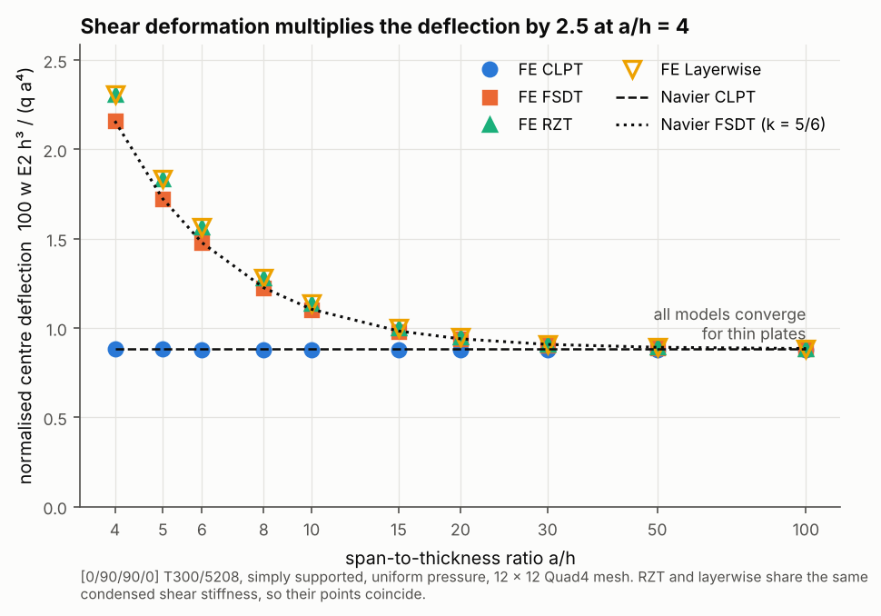

# 01 · Kinematic models vs plate thickness

How much does transverse shear deformation matter, and which theory captures it?
This example solves one plate with all four kinematic models while the
span-to-thickness ratio a/h goes from 100 (thin) down to 4 (very thick).



## The model

| Item | Value |
|---|---|
| Laminate | [0/90/90/0] T300/5208, equal ply thicknesses |
| Plate | 200 mm square, a/h = 4, 5, 6, 8, 10, 15, 20, 30, 50, 100 |
| Supports | simply supported on all edges (w = 0, tangential rotation held) |
| Load | uniform pressure q = 10 kPa |
| Mesh | 12 × 12 Quad4 |
| Models | `CLPTModel`, `FSDTModel` (k = 5/6), `RefinedZigZagModel`, `LayerwiseModel` |

```bash
python examples/01_kinematic_models/kinematic_models.py
```

## Walkthrough

1. **Build the laminate** for each thickness from the T300/5208 card in the
   default material library:

   ```python
   card = create_default_library().get("T300/5208")
   lam = Laminate.from_angles(card, [0, 90, 90, 0], (A / ratio) / 4)
   ```

2. **Mesh and solve once per model.** The kinematic model is a strategy passed to
   the mesh, so nothing else changes between runs:

   ```python
   mesh = FEAMesh.rectangular_plate(A, A, 12, 12, lam, FSDTModel())
   result = StructuralGlobalSolver().solve(mesh, simply_supported(mesh, A, A), LoadCase().add_pressure(Q))
   w = result.node_displacement(mesh.closest_node((A / 2, A / 2)))[2]
   ```

3. **Normalise** the centre deflection as w̄ = 100 · w · E2 · h³ / (q · a⁴), which
   makes the thin-plate answer independent of thickness.

4. **Compare** with the Navier double-sine series for CLPT and FSDT
   (`_shared/analytical.py`).

## Reading the figure

- **CLPT is flat at w̄ ≈ 0.88** because it has no shear flexibility. It matches
  the Navier CLPT line within 0.3% at every a/h.
- **The shear models rise as the plate thickens.** At a/h = 4, FSDT gives
  w̄ = 2.162 against Navier FSDT 2.159 (0.15%). That is 2.5 times the CLPT value.
- **RZT and layerwise sit above FSDT** (2.308 at a/h = 4, 7% more flexible).
  Both let each ply rotate on its own (the zig-zag), which FSDT's single
  rotation cannot do, so they capture the extra shear flexibility of a cross-ply
  stack. Example 17 checks the same theories against Pagano's exact 3D
  solution, where RZT and layerwise land within 2% and FSDT is 11% too stiff.
  For this symmetric stack the two match, because the two middle plies act as
  one layer.
- **All four converge** by a/h ≈ 50, so CLPT is enough for thin laminates and
  FSDT or better is needed below about a/h = 20.

| a/h | CLPT | FSDT | RZT | Layerwise | Navier CLPT | Navier FSDT |
|---|---|---|---|---|---|---|
| 4 | 0.881 | 2.162 | 2.308 | 2.308 | 0.883 | 2.159 |
| 10 | 0.880 | 1.103 | 1.140 | 1.140 | 0.883 | 1.105 |
| 100 | 0.880 | 0.882 | 0.883 | 0.883 | 0.883 | 0.885 |

## Things to try

- Change the stack to `[0, 45, -45, 90]s` (Navier no longer applies, but the
  FE trends do).
- Drop the mesh to 4 × 4 to see how coarse the mesh can get before the
  deflections drift from the Navier lines.
