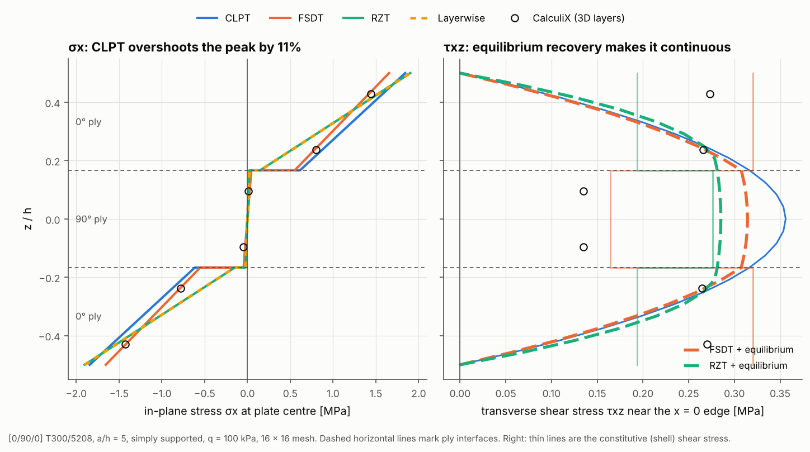

# 02 · Through-thickness stresses in a thick laminate

In-plane stresses come straight from the strains, but transverse shear stresses
depend on what the kinematic theory assumes through the thickness. This example
puts all four theories side by side in a thick [0/90/0] plate and overlays
CalculiX when it is installed.



## The model

| Item | Value |
|---|---|
| Laminate | [0/90/0] T300/5208, three equal plies |
| Plate | 100 mm square, a/h = 5 (h = 20 mm) |
| Supports | simply supported on all edges |
| Load | uniform pressure q = 100 kPa |
| Mesh | 16 × 16 Quad4 |
| Sampling | σx at the element next to the plate centre; τxz at the element next to the x = 0 edge, where shear peaks; 9 heights per ply |

```bash
python examples/02_through_thickness_stresses/through_thickness_stresses.py
```

## Walkthrough

1. **Solve each model** as in example 01.
2. **Recover stresses at any height** with `ExactStressRecoverer`. At a ply
   interface the stress has two values, so `side` picks the ply below or above:

   ```python
   rec = ExactStressRecoverer()
   u_e = result.element_displacements(element.element_id)
   point = rec.recover(element, u_e, z, side="above")
   sigma_x = point.stress_global[0]   # [σx, σy, τxy]
   tau_xz = point.shear_global[1]     # [τyz, τxz]
   ```

3. **CalculiX overlay.** `CalculiXKernelAdapter` writes an S8R composite shell
   deck, runs `ccx` and reads the layer stresses back. CalculiX reports them in
   each ply's material axes, so the script rotates them to global axes ply by
   ply before plotting.

## Reading the figure

- **σx (left)** is linear within each ply and jumps at the interfaces, because
  the 90° ply is much softer along x. FSDT, RZT and layerwise agree with each
  other and with CalculiX. CLPT, which ignores shear flexibility, overshoots the
  outer-ply peak by about 11% at this thickness.
- **τxz (right)** is where the theories differ. The thin lines are the shear
  stress straight from each shell theory's constitutive law:
  - **FSDT** has a constant shear strain, so its stress is piecewise constant
    and jumps at each interface (0.32 MPa in the 0° plies, 0.16 MPa in the
    90° ply). Interlaminar shear stress should be continuous.
  - **RZT and layerwise** (identical here) also jump: each ply's shear modulus
    multiplies a different zig-zag slope. Their gain is in the displacements and
    in-plane stresses, not in the constitutive shear.
  - **CLPT** recovers τxz from equilibrium with one parabola through the whole
    thickness, ignoring the stiffness change between plies.
  - **CalculiX** uses the FSDT-type S8R shell, so its points follow the FSDT
    pattern of a ply-wise jump.
- **The thick dashed lines** come from `EquilibriumStressRecoverer`. It
  integrates the 3D equilibrium equations through the thickness using the
  in-plane stress gradients of the solved shell, so the profile is continuous,
  zero on both faces and parabolic within each ply. It also returns σz. FSDT
  and RZT give similar shapes; RZT is closer to the exact 3D answer because its
  in-plane stresses are better (example 17 compares both with Pagano's 3D
  solution).

```python
rec = EquilibriumStressRecoverer(result, load_case)
tau_yz, tau_xz, sigma_z = rec.transverse_stresses(element, 0.0, 0.0, z)
```
