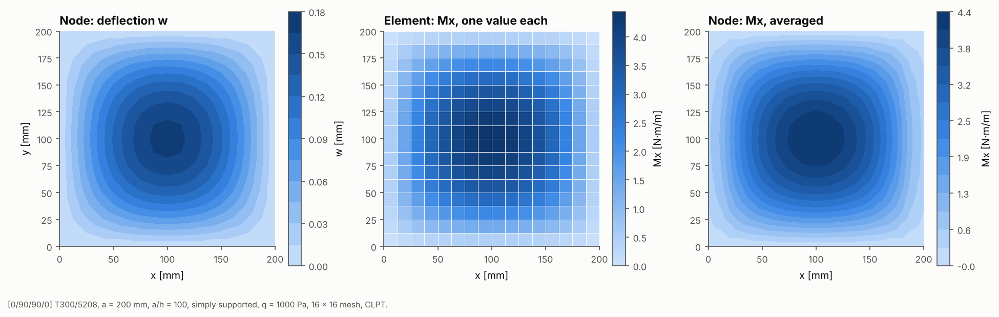
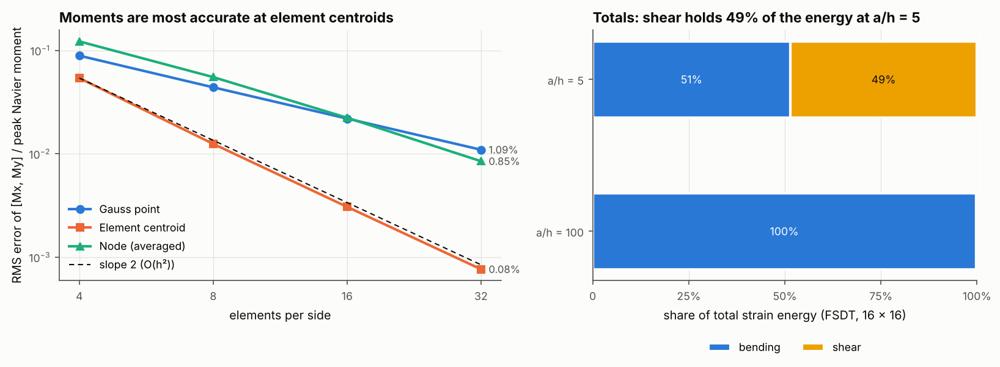

# 03 · Result fidelity: Gauss points, elements, nodes and totals

`ResultsExtractor` turns one solution into results at every level: the 2 × 2
Gauss points, the elements, the nodes, the plies and the whole model. This
example shows what each level looks like and how accurate it is.

## The model

| Item | Value |
|---|---|
| Laminate | [0/90/90/0] T300/5208 |
| Plate | 200 mm square, a/h = 100 (and a/h = 5 for the energy split) |
| Supports | simply supported on all edges |
| Load | uniform pressure q = 1 kPa |
| Mesh | 16 × 16 for the fields; 4, 8, 16 and 32 per side for convergence |

```bash
python examples/03_result_fidelity/result_fidelity.py
```

## Walkthrough

One extractor gives every level:

```python
ex = ResultsExtractor(result)          # optional: load_case, recoverer, criterion
gp = ex.gauss_points()    # GaussPointField: xyz, weight, eps0, kappa, gamma0, N, M, Q per point
el = ex.elements()        # ElementField: centroid, area, N, M, Q, energy split, worst failure index
nd = ex.nodes()           # NodalField: displacement, reaction, N, M, Q (extrapolated and averaged)
pl = ex.ply_points()      # PlyPointField: ply stresses at the bottom, middle and top of each ply
tot = ex.totals()         # GlobalTotals: strain energy split, external work, reactions, equilibrium residual
ex.to_csv("results/")     # one CSV per level
```

Resultants are mechanical: N and M are ABD · [ε0; κ] minus the hygrothermal
resultants, and Q = A_s · γ0. Nodal values are found by fitting a bilinear field
through the four Gauss points of each element, evaluating it at the corners and
averaging over the elements that share each node.

## Figure 03a: the same solution at three levels



- **Left, node:** deflection w, which is a primary nodal unknown.
- **Middle, element:** Mx with one value per element, the Gauss-point average.
  The mesh is visible in the result.
- **Right, node:** Mx after extrapolation and averaging. It is smooth and best
  for contour plots, but averaging blurs real jumps, such as where two
  different laminates meet.

## Figure 03b: accuracy and totals



**Left: convergence.** Each level is compared with the Navier series moment
field at its own sample locations (relative RMS error of [Mx, My]):

| Elements per side | 4 | 8 | 16 | 32 |
|---|---|---|---|---|
| Gauss point | 8.90% | 4.40% | 2.19% | 1.09% |
| Element centroid | 5.40% | 1.25% | 0.31% | 0.08% |
| Node (averaged) | 12.22% | 5.52% | 2.23% | 0.85% |

For this bilinear element the **element centroid is the most accurate place
to read moments** and converges at O(h²). The centroid is the element's optimal
(Barlow) sampling point for bending. The 2 × 2 Gauss points and the nodal values
converge at O(h). In practice: report stresses and resultants at element
centroids, and use nodal values for pictures.

**Right: global totals.** `totals().energy_split` divides the strain energy
into membrane, bending, membrane-bending coupling, transverse shear and drilling
parts. In the thin plate bending carries 99.7%. At a/h = 5, transverse shear
carries 49%, which is why the shear-deformable models in example 01 deflect so
much more. The totals also check the solution: strain energy equals the external
work, and the equilibrium residual is below 1e-10.
