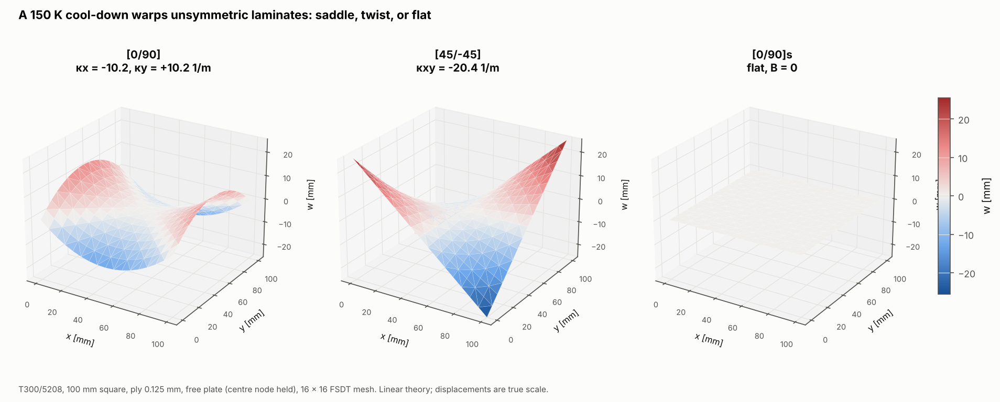

# 04 · Thermal warping of unsymmetric laminates

After curing, a laminate cools by more than 100 K. The stacking sequence alone
decides whether it stays flat. This example cools three free plates by 150 K
and compares the finite-element curvatures with laminate theory.



## The model

| Item | Value |
|---|---|
| Laminates | [0/90], [45/-45] and [0/90]s, T300/5208, 0.125 mm plies |
| Plate | 100 mm square, free edges |
| Supports | centre node fully held (removes rigid-body motion without adding stress) |
| Load | uniform ΔT = -150 K |
| Mesh | 16 × 16 Quad4, FSDT |

```bash
python examples/04_thermal_warping/thermal_warping.py
```

## Walkthrough

1. **Apply the temperature change** through the load case. It is turned into
   equivalent thermal forces and moments N_ht and M_ht for every element:

   ```python
   loads = LoadCase().set_hygrothermal(HygrothermalState(delta_temperature=-150.0))
   ```

2. **Hold only the centre node** so the plate can shrink and curl freely.
3. **Laminate-theory check:** the free-plate strains and curvatures are
   {ε0; κ} = ABD⁻¹ {N_ht; M_ht}:

   ```python
   theory = np.linalg.solve(integrate_abd(lam), HygrothermalEngine().resultant_vector(lam, state))
   ```

4. **FE curvatures** are the mean of `ResultsExtractor(...).gauss_points().kappa`.

## Reading the figure

| Stack | κx FE | κx CLT | κy FE | κy CLT | κxy FE | κxy CLT |
|---|---|---|---|---|---|---|
| [0/90] | -10.21 | -10.21 | +10.21 | +10.21 | 0 | 0 |
| [45/-45] | 0 | 0 | 0 | 0 | -20.42 | -20.42 |
| [0/90]s | 0 | 0 | 0 | 0 | 0 | 0 |

Curvatures are in 1/m, and the FE results match laminate theory to every digit shown.

- **[0/90]** has B11 = -B22 coupling, so the cool-down bends it in opposite
  directions in x and y: a saddle.
- **[45/-45]** has B16 and B26 coupling, so it twists.
- **[0/90]s** is symmetric, so B = 0 and it only shrinks in plane.

**Linear theory caveat.** The predicted corner deflections (about 25 mm) are
100 times the plate thickness, far outside small-deflection theory. Real thin
[0/90] plates of this size snap to a cylinder instead of a saddle, which is a
geometrically nonlinear effect and outside this package's scope. Read the
saddle as the linear prediction of the curvature the stack wants, not as the
final shape.
