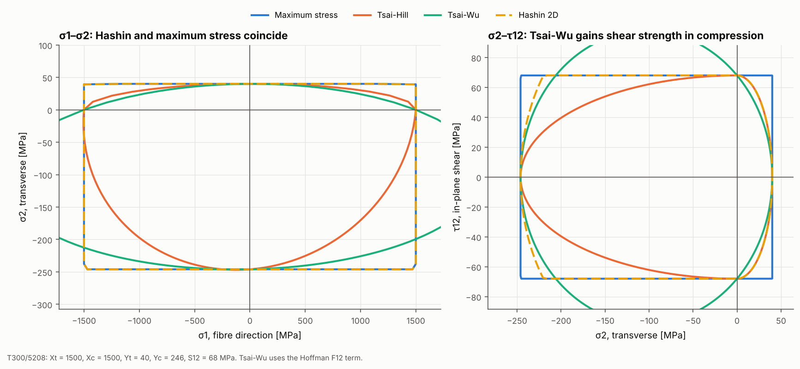

# 05 · Failure envelopes of a unidirectional ply

The four failure criteria in the package agree on uniaxial strength by
construction but differ under combined stress. This example draws each
criterion's failure envelope for a T300/5208 ply in two stress planes.



## The model

| Item | Value |
|---|---|
| Material | T300/5208: Xt = Xc = 1500, Yt = 40, Yc = 246, S12 = 68 MPa |
| Criteria | `MaximumStressCriterion`, `TsaiHillCriterion`, `TsaiWuCriterion` (Hoffman F12), `HashinCriterion("2d")` |
| Load paths | 720 radial directions in each plane |

```bash
python examples/05_failure_envelopes/failure_envelopes.py
```

## Walkthrough

Every criterion takes a 3D stress in material axes, Voigt order
[σ11, σ22, σ33, τ23, τ13, τ12], and returns a `FailureResult`:

```python
result = TsaiWuCriterion().evaluate(stress, card.strength)
result.index            # failure index, 1 = failure
result.strength_ratio   # factor on the applied stress to reach failure
result.mode             # e.g. FailureMode.MATRIX_TENSION
```

Because `strength_ratio` is the load factor to failure, scaling a unit stress
direction by it gives a point on the envelope. The script repeats this for 720
directions in each plane.

## Reading the figure

- **σ1–σ2 (left).** Maximum stress and Hashin 2D coincide here (Hashin's fibre
  and matrix modes are independent when τ12 = 0), giving a rectangle. Tsai-Hill
  rounds the corners. Tsai-Wu is one smooth ellipse. Because of the large
  difference between Yt and Yc, it allows fibre stresses beyond Xt when σ2 is
  compressive. This is a known Tsai-Wu artefact for real laminates.
- **σ2–τ12 (right).** This is the matrix-dominated plane, where the choice of
  criterion matters most. Under equal transverse compression and shear
  (σ2 = -τ12), failure is predicted at:

  | Criterion | Failure at \|σ\| |
  |---|---|
  | Maximum stress | 96 MPa |
  | Tsai-Hill | 93 MPa |
  | Hashin 2D | 96 MPa |
  | Tsai-Wu | 139 MPa |

  Tsai-Wu's linear terms raise the shear strength under transverse compression
  by about 45% over the other three criteria.

The criteria plug into `ProgressiveDamageAnalysis` (example 06) and
`ResultsExtractor(criterion=...)` the same way.
