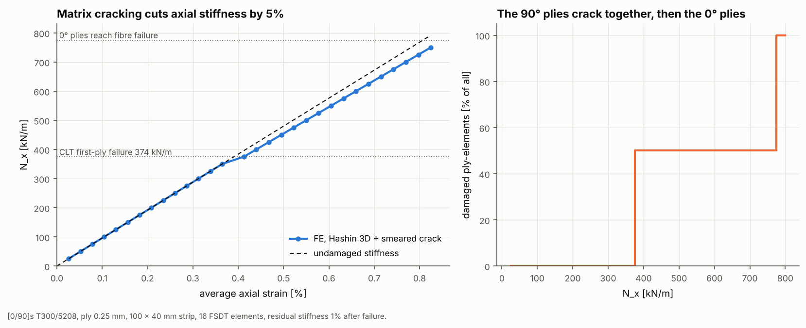

# 06 · Progressive damage of a cross-ply strip in tension

A [0/90]s laminate in tension does not fail all at once. The 90° plies crack
first, the laminate softens slightly, and it carries on until the 0° fibres
break. `ProgressiveDamageAnalysis` follows this sequence with a series of
linear static solves.



## The model

| Item | Value |
|---|---|
| Laminate | [0/90/90/0] T300/5208, 0.25 mm plies (h = 1 mm) |
| Specimen | 100 × 40 mm strip, 8 × 2 Quad4, FSDT |
| Supports | left edge held in x, one corner held in y, out-of-plane DOFs held |
| Load | line load N_x on the right edge, stepped from 25 to 800 kN/m |
| Criterion | `HashinCriterion("3d")` |
| Degradation | `SmearedCrackDegradation(0.01)`: failed moduli drop to 1% |

```bash
python examples/06_progressive_damage/progressive_damage.py
```

## Walkthrough

```python
analysis = ProgressiveDamageAnalysis(criterion=HashinCriterion("3d"),
                                     degradation=SmearedCrackDegradation(0.01))
result = analysis.run(mesh, bcs, loads, load_factors=np.arange(0.25, 8.01, 0.25))
```

At each load factor the analysis:

1. solves the current (possibly damaged) model with a linear static solve;
2. recovers ply stresses at the bottom, middle and top of every ply at each
   element centre and evaluates the criterion;
3. degrades the newly failed plies according to their failure mode (matrix
   cracking reduces E2, G12, G23 and ν12; fibre failure reduces E1);
4. re-solves the same load step until no new damage appears.

`result.steps` records the load factor, iterations, damaged ply count, maximum
failure index and maximum displacement of every step. `result.first_ply_failure_factor`
gives the first-ply failure load.

## Reading the figure

| Event | N_x |
|---|---|
| First-ply failure, laminate theory | 374.3 kN/m |
| First-ply failure, FE (Hashin 3D matrix tension in the 90° plies) | 375 kN/m (first load step above 374.3) |
| Fibre failure of the 0° plies | 775 kN/m |

- **Left:** the load-strain line follows the undamaged stiffness up to
  first-ply failure, then bends. Once the 90° plies have cracked, the axial
  stiffness is about 5% lower, which matches the small share the 90° plies
  carry along x. The 0° plies then take the load until their fibres fail.
- **Right:** all 32 ply-elements in the 90° plies (50% of the total) crack in
  the same step because the stress is uniform. The 0° plies follow when they
  reach fibre failure.

The degradation is instant and depends on the mesh, and post-failure points are
not drawn beyond fibre failure. Energy-regularised damage is on the roadmap.
