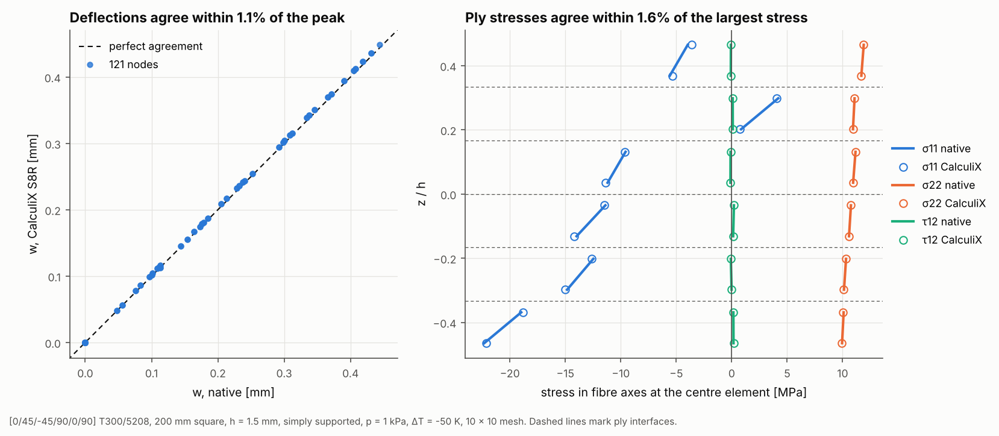

# 07 · Cross-check against CalculiX

The package can run the same model through three solver kernels. This example
runs the benchmark plate through the native solver and CalculiX and compares
displacements and ply stresses.



## The model

The model is the one the `laminate-benchmarks` runner (`composite_laminate_model.run_solver_benchmarks`) builds:

| Item | Value |
|---|---|
| Laminate | [0/45/-45/90/0/90] T300/5208, 0.25 mm plies (unsymmetric) |
| Plate | 200 mm square, simply supported |
| Load | 1 kPa pressure plus a 50 K cool-down |
| Mesh | 10 × 10 Quad4 (native) / S8R with mid-side nodes (CalculiX) |

Requires `ccx` on the `PATH` (`apt install calculix-ccx`, tested with ccx 2.21).

```bash
python examples/07_calculix_crosscheck/calculix_crosscheck.py
```

## Walkthrough

1. **One model, two kernels.** `AnalysisModel` holds the mesh, supports, loads
   and the elements to monitor. Each kernel returns a `KernelResult` with
   displacements and stress profiles in the same format:

   ```python
   model = build_model(n=10, pressure=1.0e3, delta_t=-50.0)
   native = NativePythonKernelAdapter().run(model)
   ccx = CalculiXKernelAdapter(work_dir=...).run(model)
   ```

   The CalculiX adapter promotes each Quad4 to an S8R composite shell, because
   CalculiX only supports composite sections on 8-node shells. It writes the
   deck, runs `ccx` and parses the `.dat` output.

2. **Compare** with `StressDistributionVerifier`, which reports MAE, maximum
   error and RMS error for each quantity:

   ```python
   verifier = StressDistributionVerifier()
   stats = verifier.compare_displacements(native.displacements, ccx.displacements)
   profile = verifier.compare_profiles(native.profile(eid, "material"), ccx.profile(eid, "material"))
   ```

## Reading the figure

| Quantity | Max error / peak |
|---|---|
| UX | 0.49% |
| UY | 0.58% |
| UZ | 1.12% |
| σ11 at the centre element | 1.64% |
| σ22 | 0.36% |
| τ12 | 0.1% of the largest stress (14.4% of its own small peak) |

- **Left:** every corner node's deflection lies on the line of perfect
  agreement. The 1% difference comes from the two element formulations
  (bilinear MITC4 against quadratic S8R).
- **Right:** in-plane ply stresses in fibre axes at both integration heights of
  each ply. Each ply is drawn as its own segment because the stress jumps at
  interfaces. Both solvers give the same stress distribution, which is not
  symmetric about the mid-plane because the stack is unsymmetric.

`laminate-benchmarks` prints the same comparison as tables, also
timing each kernel and adding the Nastran deck.
