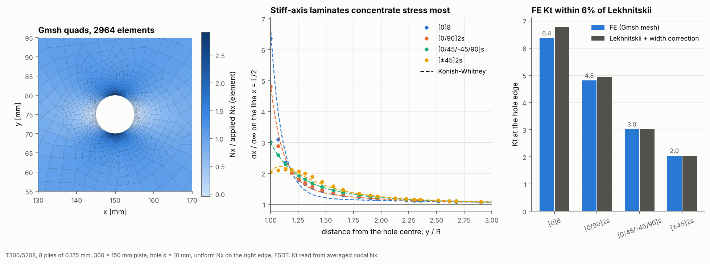

# 08 · Open-hole tension meshed with Gmsh

A hole is the classic composite design detail, and the first geometry here that
needs a general mesh. This example meshes a plate with a central hole in Gmsh,
grades the quads down to 0.3 mm at the hole edge, and compares the stress
concentration of four laminates with Lekhnitskii's orthotropic solution.



## The model

| Item | Value |
|---|---|
| Laminates | [0]8, [0/90]2s, [0/45/-45/90]s and [±45]2s, T300/5208, 0.125 mm plies |
| Plate | 300 × 150 mm with a central 10 mm hole (W/d = 15) |
| Mesh | Gmsh curved Quad8 (the default element): 12 mm far away, 0.3 mm on the hole edge, graded over 6 hole radii (about 3,000 elements) |
| Supports | left edge held in x, one node held in y, out-of-plane DOFs held |
| Load | uniform line load N_x = 100 kN/m on the right edge |
| Model | FSDT |

Needs Gmsh: `pip install -e ".[gmsh]"`. On a headless Linux machine Gmsh also
needs the OpenGL runtime: `apt install libglu1-mesa`.

```bash
python examples/08_open_hole_gmsh/open_hole_gmsh.py
```

## Walkthrough

1. **Build and mesh the geometry.** `GmshPlateBuilder` draws the plate and
   holes with Gmsh's OpenCASCADE kernel, sets a size field around the holes,
   recombines the mesh into quads and imports it:

   ```python
   builder = GmshPlateBuilder(0.3, 0.15, [CircularHole(0.15, 0.075, 0.005)],
                              size=0.012, hole_size=0.0003, transition=6)
   gm = builder.build(GmshMeshImporter(laminate, FSDTModel()))
   gm.mesh            # an ordinary FEAMesh
   gm.nodes("left")   # named node sets: left, right, bottom, top, hole_1, plate
   ```

2. **Apply loads by name.** The right-edge nodes get a share of N_x equal to
   half the length of each neighbouring edge segment, which is the consistent
   load for a uniform line load on a graded edge.

3. **Read Kt** from the averaged nodal N_x at the node on top of the hole,
   divided by the applied N_x. The profile in the middle panel uses the nodes
   nearest to the line x = L/2.

4. **Analytical reference.** The laminate's effective Ex, Ey, Gxy and νxy come
   from the inverse of its A matrix. Lekhnitskii's infinite-plate value is
   Kt∞ = 1 + √(2(√(Ex/Ey) − νxy) + Ex/Gxy), corrected for finite width with
   the isotropic factor (2 + (1 − d/W)³) / (3(1 − d/W)).

### Your own geometry

Any Gmsh model works, as long as it is meshed in quads. Name the regions and
edges with physical groups, then import:

```python
importer = GmshMeshImporter({"skin": skin_laminate, "doubler": doubler_laminate}, FSDTModel())
gm = importer.from_file("panel.geo")   # .geo, .step or .brep is meshed in quads; .msh is read as is
gm.elements("doubler")                 # element ids in that physical surface
gm.nodes("clamped_edge")               # node ids in any physical group
```

## Reading the figure

| Laminate | Kt (FE) | Kt (Lekhnitskii) | Difference |
|---|---|---|---|
| [0]8 | 6.37 | 6.78 | −6.1% |
| [0/90]2s | 4.81 | 4.94 | −2.6% |
| [0/45/-45/90]s | 3.01 | 3.01 | 0.0% |
| [±45]2s | 2.04 | 2.03 | +0.5% |

- **Left:** the graded Gmsh mesh with element N_x for the quasi-isotropic
  laminate. The load flows around the hole and peaks at its top and bottom.
- **Middle:** stress decay from the hole edge. The stiffer the laminate is along
  the load relative to its shear stiffness, the higher and narrower the peak.
  [±45]2s has its maximum slightly inside the plate rather than at the edge, as
  the Konish-Whitney curve also shows. Konish-Whitney is itself an
  approximation and is least accurate for [0]8.
- **Right:** FE matches Lekhnitskii within 3% for three of the four stacks. The
  [0]8 stack reads 6% low: its peak is the narrowest (middle panel), and
  nodal averaging over the elements at the edge smooths it.
  The error falls as the hole-edge elements shrink. With Quad4 elements on the
  same mesh, [0]8 reads 11% low and [0/90]2s 5% low, which is why this example
  uses the default quadratic element (example 18 compares all five).
