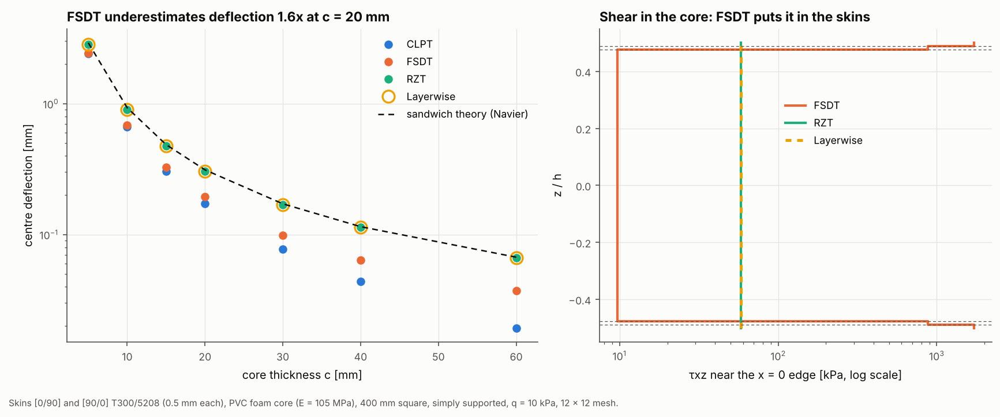

# 09 · Sandwich panel with a foam core

Sandwich panels are where the choice of kinematic theory matters most. The
foam core is about 1,700 times less stiff than the carbon skins, so it carries
almost all the transverse shear deformation. This example shows which theories
capture that.



## The model

| Item | Value |
|---|---|
| Skins | [0/90] bottom and [90/0] top, T300/5208, 0.25 mm plies (0.5 mm per skin) |
| Core | PVC foam, E = 105 MPa, ν = 0.3 (G = 40 MPa), thickness 5 to 60 mm |
| Plate | 400 mm square, simply supported |
| Load | uniform pressure q = 10 kPa |
| Mesh | 12 × 12 Quad4, each of the four kinematic models |

```bash
python examples/09_sandwich_panel/sandwich_panel.py
```

## Walkthrough

1. **Define the core material.** A `MaterialCard` bundles elastic, strength,
   hygrothermal and density data:

   ```python
   FOAM = MaterialCard(name="PVC foam H100", elastic=ElasticProperties3D.isotropic(105e6, 0.3),
                       strength=StrengthProperties3D(3.1e6, 1.9e6, 3.1e6, 1.9e6, 1.6e6), density=100.0)
   ```

2. **Stack plies of different materials and thicknesses** with `Ply` and
   `Laminate` (`Laminate.from_angles` only covers one material):

   ```python
   plies = [Ply(skin, 0.25e-3, 0), Ply(skin, 0.25e-3, 90), Ply(FOAM, c, 0),
            Ply(skin, 0.25e-3, 90), Ply(skin, 0.25e-3, 0)]
   lam = Laminate(plies)
   ```

3. **Solve with each kinematic model** and compare with classical sandwich
   theory. That is the Navier FSDT series with the sandwich shear stiffness
   S = G_core · d² / c, where d is the distance between skin centroids.

## Reading the figure

| Core c [mm] | CLPT | FSDT | RZT | Layerwise | Sandwich theory |
|---|---|---|---|---|---|
| 5 | 2.42 | 2.45 | 2.83 | 2.83 | 2.91 |
| 20 | 0.173 | 0.196 | 0.306 | 0.306 | 0.312 |
| 60 | 0.019 | 0.037 | 0.067 | 0.067 | 0.067 |

Centre deflections are in mm.

- **Left:** RZT and layerwise sit on the sandwich-theory line within 3%. FSDT
  is barely more flexible than CLPT, and at c = 20 mm it underestimates the
  deflection 1.6 times. The cause is how FSDT builds its shear stiffness: it
  adds G·h over the plies, so the 1 mm of carbon skins (G13 = 7.2 GPa)
  outweighs the 20 mm of foam (G = 40 MPa). The zig-zag and layerwise models
  add the shear compliances instead, so the soft core controls.
- **Right:** the transverse shear stress near the support (log scale). FSDT
  puts 0.9 to 1.7 MPa in the skins and only 10 kPa in the core. In a real
  sandwich the core carries the shear at roughly Q/d, which is what RZT and
  layerwise give (about 60 kPa, uniform through the thickness).

For sandwich structures, use `RefinedZigZagModel` or `LayerwiseModel`. FSDT's
5/6 shear correction factor is only meant for a single material.
