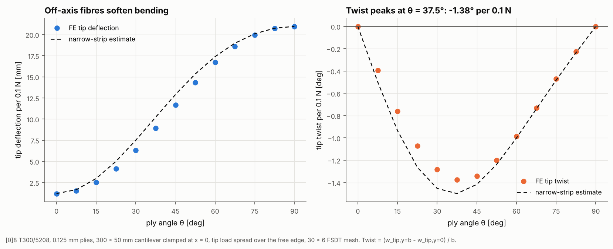

# 10 · Bending-twist coupling in a cantilever

When the fibres of a beam-like laminate are not aligned with its span, bending
it also twists it. Wind-turbine blades and forward-swept wings use this
deliberately so that bending under gusts twists the section to shed load
(aeroelastic tailoring). This example sweeps the ply angle of a cantilever
strip and measures the twist it buys.



## The model

| Item | Value |
|---|---|
| Laminate | [θ]8 T300/5208, 0.125 mm plies, θ = 0° to 90° in 7.5° steps |
| Strip | 300 × 50 mm, clamped at x = 0 (all six DOFs) |
| Load | 0.1 N transverse tip force spread over the free edge |
| Mesh | 30 × 6 Quad4, FSDT |

```bash
python examples/10_bending_twist_coupling/bending_twist_coupling.py
```

## Walkthrough

1. **Clamp one end** by fixing every DOF on the line x = 0, and **load the tip**
   by spreading the force over the tip nodes (half shares at the corners).
2. **Measure** the mean tip deflection and the tip twist
   φ = (w at y = b − w at y = 0) / b.
3. **Narrow-strip estimate.** With d = D⁻¹ and only M_x = P(L − x)/b acting,
   the curvatures are κ = d · [M_x, 0, 0]. Integrating along the span gives
   w_tip = d11 · P · L³ / (3b) and φ_tip = d16 · P · L² / (4b).

## Reading the figure

| θ | Tip deflection FE [mm] | Narrow strip [mm] | Tip twist FE [deg] | Narrow strip [deg] |
|---|---|---|---|---|
| 0° | 1.19 | 1.19 | 0 | 0 |
| 22.5° | 4.13 | 5.00 | -1.07 | -1.26 |
| 37.5° | 8.92 | 10.22 | -1.38 | -1.50 |
| 90° | 20.96 | 20.97 | 0 | 0 |

- **Twist peaks near θ = 37.5°**, where D16 relative to the bending stiffness
  is largest. At 0° and 90°, D16 = 0, so there is no coupling.
- **The FE twist is 4 to 21% below the estimate.** The clamp stops the root
  from twisting and from curling sideways, which the narrow-strip estimate
  ignores. The difference is largest at small angles, where the strip is
  stiffest and the root restraint carries further along the span.
- **Bending stiffness drops fast off-axis.** At 22.5° the strip is already
  3.5 times more flexible than at 0°, so tailoring trades bending stiffness for
  twist.

Results scale linearly with the load, so per-newton values are 10 times the
numbers shown.
