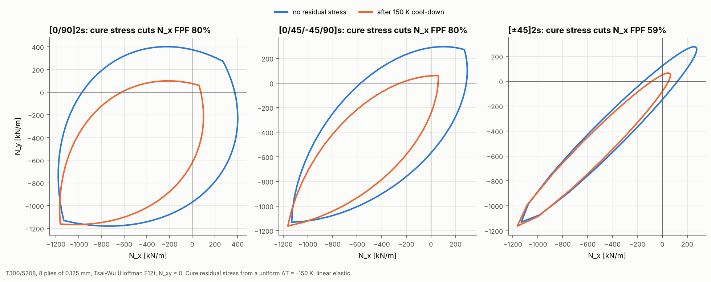

# 11 · Laminate first-ply failure envelopes and cure stress

A laminate's in-plane strength is often drawn as a first-ply failure (FPF)
envelope in N_x–N_y space. This example draws it for three stacks, then again
with the residual stress from a 150 K cure cool-down locked in.



## The model

| Item | Value |
|---|---|
| Laminates | [0/90]2s, [0/45/-45/90]s, [±45]2s; T300/5208, 0.125 mm plies |
| Load | N_x and N_y along 144 radial paths, N_xy = 0 |
| Residual stress | uniform ΔT = -150 K (cure to room temperature) |
| Criterion | Tsai-Wu (Hoffman F12) |

```bash
python examples/11_laminate_failure_envelope/laminate_failure_envelope.py
```

## Walkthrough

1. **One free element is enough.** Under uniform membrane loads, a symmetric
   laminate has the same strain everywhere, so a single Quad4 held only against
   rigid-body motion is exact. `_shared/membrane.py` loads it with self-balanced
   edge forces for unit N_x, N_y and N_xy, plus the cool-down, and recovers the
   ply stresses at three heights per ply:

   ```python
   cell = MembraneCell.build(laminate, HygrothermalState(delta_temperature=-150.0))
   scale, ply = cell.failure_load(TsaiWuCriterion(), direction=[cos(t), sin(t), 0])
   ```

2. **Superpose.** Any load is a linear combination of the unit cases, plus the
   residual stress when it is included. `failure_load` finds by bisection the
   load factor along a direction at which the worst ply reaches Tsai-Wu = 1.
   The bisection is needed because the residual stress makes the failure index
   non-linear in the load.

3. **Check.** Under N_x alone, without residual stress, the [0/90]2s FPF is
   374.3 kN/m. That matches the laminate-theory value from the tests exactly.

## Reading the figure

| Laminate | N_x FPF, no residual [kN/m] | After cool-down [kN/m] |
|---|---|---|
| [0/90]2s | 374 | 75 |
| [0/45/-45/90]s | 288 | 59 |
| [±45]2s | 123 | 50 |

- **Cure stress shrinks every envelope.** The matrix wants to shrink much more
  across the fibres than along them. In a cross-ply, each ply's transverse
  shrinkage is restrained by its neighbours' fibres, which leaves about 32 MPa
  of transverse tension against a 40 MPa transverse strength before any load
  is applied.
- **[±45]2s loses less** (59%, against 80% for the other two), but its
  first-ply failure load was already the lowest.
- **Biaxial compression is barely affected**, because the transverse residual
  tension partly cancels the applied compression.

This is a linear elastic upper bound on the effect. Real cure stresses relax
viscoelastically, and thin plies have higher in-situ transverse strength. Both
reduce the loss in practice, but the trend is why cure stress is in
every composite design check.
