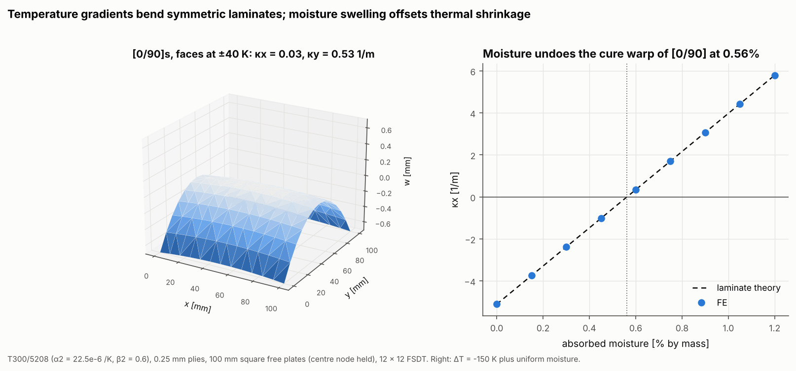

# 12 · Temperature gradients and moisture swelling

Example 04 showed that a uniform temperature change warps only unsymmetric
laminates. This example covers two other hygrothermal cases: a temperature
difference between the faces, and moisture absorbed in service.



## The model

| Item | Left | Right |
|---|---|---|
| Laminate | [0/90]s T300/5208, 0.25 mm plies | [0/90] T300/5208, 0.25 mm plies |
| Plate | 100 mm square, free (centre node held) | same |
| Environment | top face +40 K, bottom face -40 K (linear gradient) | ΔT = -150 K cure plus 0 to 1.2% absorbed moisture |
| Mesh | 12 × 12 Quad4, FSDT | same |

```bash
python examples/12_temperature_gradient_and_moisture/temperature_gradient_and_moisture.py
```

## Walkthrough

`HygrothermalState` describes a temperature and moisture field that varies
linearly through the thickness:

```python
# dT(z) = delta_temperature + temperature_gradient * z, likewise for moisture
HygrothermalState(temperature_gradient=2 * 40.0 / h)                 # faces at +-40 K
HygrothermalState(delta_temperature=-150.0, delta_moisture=0.006)   # cured, then 0.6% moisture
```

The package turns each state into equivalent thermal forces and moments
{N_ht; M_ht} in every element and into a consistent element load vector. Stress
recovery subtracts the free hygrothermal strain, so only the mechanical part
produces stress. The laminate-theory check is again {ε0; κ} = ABD⁻¹{N_ht; M_ht}.

## Reading the figure

- **Left: a gradient bends a symmetric laminate.** The FE curvatures
  (κx = 0.035, κy = 0.531 1/m) match laminate theory to four digits. Nearly all
  the curvature is κy, so the plate curls into a near-cylinder. The outer
  0° plies have almost no thermal expansion along x (α1 = 0.02e-6/K), so the hot
  face can only grow across the fibres.
- **Right: moisture undoes the cure warp.** The cured [0/90] plate starts at
  κx = -5.1 1/m. Absorbed moisture swells the matrix across the fibres
  (β2 = 0.6 per unit moisture), which works against the thermal shrinkage
  (α2 · ΔT = -3.4e-3). The two cancel at 0.56% moisture, after which the
  plate warps the other way. Every FE point sits on the laminate-theory line.

This is why unsymmetric laminates are avoided in practice: their shape changes
with temperature and humidity in service.
