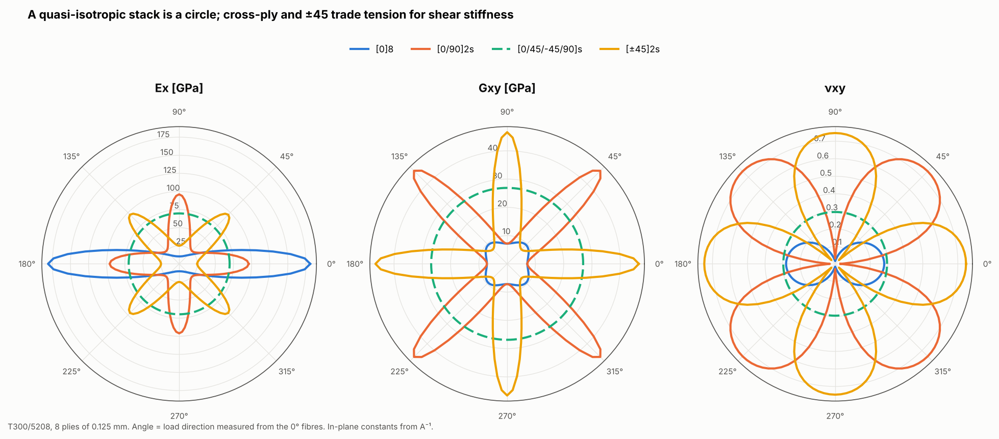

# 13 · Directional stiffness: polar plots

A laminate's in-plane stiffness depends on the loading direction, and the
stacking sequence controls how. This example plots Ex, Gxy and νxy against
direction for four stacks.



## The model

| Item | Value |
|---|---|
| Stacks | [0]8, [0/90]2s, [0/45/-45/90]s, [±45]2s; T300/5208, 0.125 mm plies |
| Directions | 0° to 360° in 2.5° steps |

```bash
python examples/13_stiffness_polars/stiffness_polars.py
```

## Walkthrough

Loading at angle φ is the same as rotating every ply by -φ, so the script
rebuilds the laminate for each direction and reads the effective constants from
the inverse of the A matrix:

```python
lam = Laminate.from_angles(card, [a - phi for a in angles], ply_t)
a = np.linalg.inv(integrate_abd(lam)[:3, :3])
Ex, Gxy, nu_xy = 1 / (h * a[0, 0]), 1 / (h * a[2, 2]), -a[0, 1] / a[0, 0]
```

`Ply` builds Q̄ with the Reuter-matrix transformation, and `integrate_abd` sums
the plies. No mesh is needed: this is the laminate-level part of the package
that every element uses.

## Reading the figure

| Stack | Ex at 0° [GPa] | Ex at 45° [GPa] | Gxy at 0° [GPa] | νxy at 0° |
|---|---|---|---|---|
| [0]8 | 181.0 | 16.7 | 7.2 | 0.28 |
| [0/90]2s | 96.0 | 25.1 | 7.2 | 0.03 |
| [0/45/-45/90]s | 69.7 | 69.7 | 26.9 | 0.30 |
| [±45]2s | 25.1 | 96.0 | 46.6 | 0.75 |

- **The quasi-isotropic stack is a circle** in all three plots: its in-plane
  stiffness is the same in every direction.
- **Cross-ply and ±45 are the same laminate rotated by 45°.** [0/90]2s has
  Ex = 96 GPa along the fibres and 25 GPa at 45°. [±45]2s is the reverse, which
  is why it is used in shear webs and torsion skins.
- **[±45]2s has νxy = 0.75**, well above the isotropic limit of 0.5. This is
  allowed for orthotropic materials and is a well-known ±45 result.
