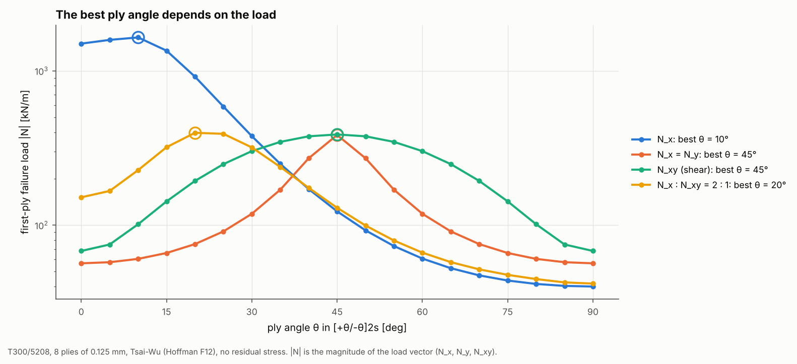

# 14 · Ply-angle sweep for laminate design

The simplest laminate optimisation is choosing one ply angle. This example
sweeps θ in [+θ/-θ]2s and finds the angle that gives the highest first-ply
failure load for four load cases.



## The model

| Item | Value |
|---|---|
| Laminate | [+θ/-θ]2s T300/5208, 0.125 mm plies, θ = 0° to 90° in 5° steps |
| Load cases | N_x; N_x = N_y; N_xy (pure shear); N_x : N_xy = 2 : 1 |
| Criterion | Tsai-Wu (Hoffman F12), no residual stress |

```bash
python examples/14_ply_angle_sweep/ply_angle_sweep.py
```

## Walkthrough

For each angle, the script builds the laminate, finds its unit-load ply stresses
on one free element (`_shared/membrane.py`, as in example 11), and finds the
failure load along each load direction:

```python
for theta in range(0, 91, 5):
    lam = Laminate.from_angles(card, [theta, -theta] * 2 + [-theta, theta] * 2, ply_t)
    cell = MembraneCell.build(lam)
    fpf = cell.failure_load(TsaiWuCriterion(), direction)[0]
```

The 19 angles × 4 load cases take about 3 seconds in total, because each
laminate needs only three unit solves.

## Reading the figure

| Load case | Best θ | FPF load |N| [kN/m] |
|---|---|---|
| N_x | 10° | 1645 |
| N_x = N_y | 45° | 384 |
| N_xy | 45° | 387 |
| N_x : N_xy = 2 : 1 | 20° | 397 |

- **Uniaxial tension wants fibres along the load.** Tsai-Wu puts the optimum at
  10° rather than 0°. Its quadratic surface lets the fibres carry more than Xt
  when the matrix is in transverse compression, which a small angle creates
  (see example 05). A maximum-stress or Hashin check would put it at 0°.
- **Shear wants ±45°**, where the fibres carry the shear as tension and
  compression.
- **Equibiaxial load wants ±45°.** For [±θ] under N_x = N_y, θ and 90° − θ are
  equivalent, and 45° balances the two directions.
- **Combined N_x and N_xy** finds a compromise at 20°.
- **The penalty for the wrong angle is large.** The y-axis is logarithmic, so
  choosing θ for shear when the load is tension costs more than a factor of 10.
