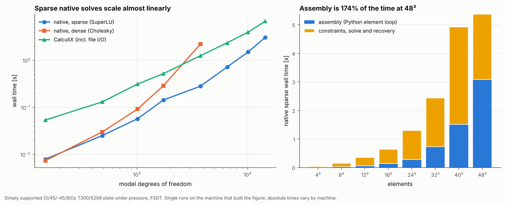

# 15 · Solver scaling

How long does a model take, and where does the time go? This example times the
same plate on meshes from 4 × 4 to 48 × 48 elements with each solver path.



## The model

| Item | Value |
|---|---|
| Plate | 200 mm square [0/45/-45/90]s T300/5208, simply supported, 1 kPa pressure, FSDT |
| Meshes | 4², 8², 12², 16², 24², 32², 40², 48² elements (150 to 14,406 DOF) |
| Solvers | native sparse (SciPy SuperLU), native dense (NumPy Cholesky, up to 24²), CalculiX |

```bash
python examples/15_solver_scaling/solver_scaling.py
```

## Walkthrough

The linear solver is a strategy passed to `StructuralGlobalSolver`, so changing
the back end is one argument:

```python
StructuralGlobalSolver(linear_solver=SparseLinearSolver()).solve(mesh, bcs, loads)
StructuralGlobalSolver(linear_solver=DenseLinearSolver()).solve(mesh, bcs, loads)
CalculiXKernelAdapter(work_dir=...).run(AnalysisModel(mesh, bcs, loads, "plate"))
```

The assembly time is measured separately with
`GlobalAssembler().assemble_stiffness(mesh)`.

## Reading the figure

Wall times from the machine that built the figure (single runs, so expect some
noise):

| Mesh | DOF | Assembly [s] | Native sparse [s] | Native dense [s] | CalculiX [s] |
|---|---|---|---|---|---|
| 8² | 486 | 0.09 | 0.11 | 0.12 | 0.18 |
| 24² | 3,750 | 0.59 | 0.91 | 2.91 | 1.35 |
| 48² | 14,406 | 2.44 | 4.47 | – | 7.43 |

- **The sparse native solver scales almost linearly** with the number of DOFs
  over this range. The dense solver grows much faster and needs memory that
  grows with the square of the DOF count, so it is only for small models or
  machines without SciPy.
- **CalculiX is slower here** because its time includes writing the deck,
  starting `ccx` and parsing the text output, and because its S8R mesh has about
  three times as many nodes as the Quad4 mesh.
- **Assembly is about half the native time.** The element stiffness loop runs in
  Python. Vectorising it, or caching identical element matrices on a regular
  mesh, is the obvious speed-up if large models become routine.
