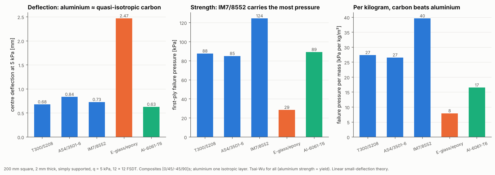

# 16 · Material comparison

The same plate built from each material in the default library: which is
stiffest, which is strongest, and which is best per kilogram?



## The model

| Item | Value |
|---|---|
| Materials | T300/5208, AS4/3501-6, IM7/8552, E-glass/epoxy, Al-6061-T6 (all from `create_default_library()`) |
| Laminate | composites [0/45/-45/90]s with 0.25 mm plies; aluminium as one 2 mm layer |
| Plate | 200 mm square, 2 mm thick, simply supported |
| Load | uniform pressure q = 5 kPa |
| Mesh | 12 × 12 Quad4, FSDT |
| Criterion | Tsai-Wu for all (aluminium strength = yield) |

```bash
python examples/16_material_comparison/material_comparison.py
```

## Walkthrough

1. **Loop over the library.** Each `MaterialCard` carries elastic constants,
   strengths, expansion coefficients and density, so swapping materials is one
   line:

   ```python
   library = create_default_library()
   for name in library.names():
       card = library.get(name)
   ```

2. **Failure pressure.** `ResultsExtractor(result).ply_points()` gives the
   material-axis stresses at the bottom, middle and top of every ply in every
   element. The smallest Tsai-Wu strength ratio over all of them, times the
   applied pressure, is the first-ply failure pressure. Linear analysis makes
   this exact.

3. **Mass per area** is density × thickness.

## Reading the figure

| Material | Deflection [mm] | FPF pressure [kPa] | Mass [kg/m²] | FPF pressure per mass |
|---|---|---|---|---|
| T300/5208 | 0.68 | 88 | 3.20 | 27 |
| AS4/3501-6 | 0.84 | 85 | 3.20 | 27 |
| IM7/8552 | 0.73 | 124 | 3.14 | 40 |
| E-glass/epoxy | 2.47 | 29 | 3.60 | 8 |
| Al-6061-T6 | 0.63 | 89 | 5.40 | 17 |

- **At equal thickness, aluminium is as stiff as quasi-isotropic carbon.** A
  quasi-isotropic stack uses only part of the fibre stiffness in any one
  direction (its in-plane modulus is about 70 GPa, the same as aluminium).
- **IM7/8552 is the strongest**, helped by its higher transverse and shear
  strengths (Yt = 62 MPa against 40 to 57 MPa for the other carbons).
- **Per kilogram, carbon wins.** Carbon is 40% lighter, so its failure pressure
  per mass is 1.6 to 2.4 times aluminium's. E-glass is the cheap, heavy, flexible
  option.

At the failure pressures shown, the deflections would be several times the
plate thickness. Membrane stiffening would then matter, but it is outside this
linear analysis. Compare the materials at the same load, as here.
