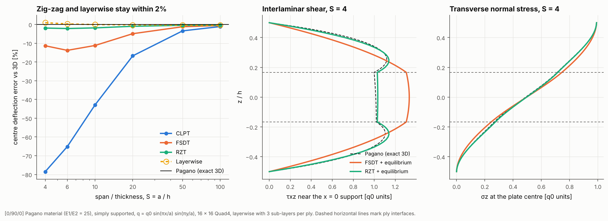

# 17 · Pagano benchmark: shell theories against exact 3D elasticity

Pagano (1970) solved a simply supported cross-ply plate under a doubly
sinusoidal pressure exactly, with no assumption about how displacements vary
through the thickness. It is the standard yardstick for laminated plate
theories. This example ranks the four kinematic models against it and checks
the transverse stresses recovered from 3D equilibrium.



## The model

| Item | Value |
|---|---|
| Laminate | [0/90/0], equal plies, E1/E2 = 25, G12 = G13 = 0.5 E2, G23 = 0.2 E2, ν = 0.25 |
| Plate | square, a = S·h with h = 10 mm, S = 4 to 100 |
| Supports | simply supported (w = 0, tangential rotation and zig-zag amplitude held) |
| Load | q = q0 sin(πx/a) sin(πy/a) on the top face, q0 = 1 |
| Mesh | 16 × 16 Quad4 |
| Models | `CLPTModel`, `FSDTModel`, `RefinedZigZagModel`, `LayerwiseModel(sublayers=3)` |
| Reference | `PaganoPlate` (transfer-matrix solution of the 3D equations) |

```bash
python examples/17_pagano_benchmark/pagano_benchmark.py
```

## Walkthrough

1. **The exact solution.** `PaganoPlate` writes the 3D equilibrium equations for
   each ply as a first-order system in z and carries it through the stack with
   matrix exponentials. Its normalised centre deflection reproduces Pagano's
   published values (w̄ = 2.006 at S = 4, 0.753 at S = 10, 0.435 at S = 100):

   ```python
   ref = PaganoPlate(lam, a, a)
   w_exact = ref.centre_deflection()
   profile = ref.profile()   # u, v, w, σx, σy, σz, τxz, τyz, τxy through z
   ```

2. **The shell solutions.** A sinusoidal pressure is a callable, so the load
   matches the 3D problem exactly:

   ```python
   loads = LoadCase().add_pressure(lambda x: np.sin(np.pi * x[0] / a) * np.sin(np.pi * x[1] / a))
   ```

3. **Transverse stresses.** `EquilibriumStressRecoverer` takes the solved shell,
   smooths the in-plane strains to the nodes, differentiates them twice and
   integrates the 3D equilibrium equations through the thickness. The result is
   continuous across plies, zero shear on both faces, and σz equal to the
   pressure on the loaded face.

## Reading the figure

| S | Pagano w̄ | CLPT | FSDT | RZT | Layerwise |
|---|---|---|---|---|---|
| 4 | 2.006 | −78.5% | −11.4% | −1.9% | +1.0% |
| 10 | 0.753 | −42.9% | −11.2% | −1.8% | −0.0% |
| 20 | 0.516 | −16.7% | −4.9% | −1.0% | −0.2% |
| 100 | 0.435 | −1.1% | −0.5% | −0.3% | −0.3% |

- **Left:** CLPT ignores shear deformation and is 79% too stiff at S = 4. FSDT
  fixes most of that but stays 11% stiff, because one rotation for the whole
  stack cannot follow the zig-zag of a soft 90° ply between stiff 0° plies.
  RZT adds one zig-zag function and is within 2%; layerwise with three
  sub-layers per ply is within 1%. All converge on the thin-plate answer (the
  remaining 0.3% at S = 100 is the mesh).
- **Middle:** interlaminar shear near a support. Both FSDT and RZT give a
  continuous profile once recovered from equilibrium, but FSDT puts too much
  shear in the middle ply (1.33 against 1.01) because its in-plane stresses are
  less accurate. RZT follows the 3D curve, including the bulge in the outer plies.
- **Right:** σz goes from 0 on the bottom to q0 on the top. Both theories are
  close, and RZT lies on the exact curve to plotting accuracy.

## Things to try

- Swap the stack for `[0, 90, 0, 90]` (unsymmetric): RZT and layerwise then
  differ, and layerwise follows the 3D solution more closely.
- Set `LayerwiseModel(sublayers=1)` to see how much the sub-layers add.
- Use `PaganoPlate(..., m=2, n=1)` for a higher mode.
