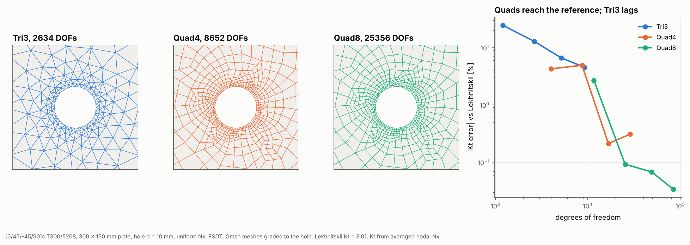

# 18 · Tri3, Quad4 and Quad8 on the open-hole plate

The package has three shell elements behind one `ShellElement` interface. This
example meshes the quasi-isotropic open-hole plate of example 08 with each of
them at four mesh sizes and compares the stress concentration at the hole edge
with Lekhnitskii's solution.



## The model

| Item | Value |
|---|---|
| Laminate | [0/45/−45/90]s T300/5208, 0.125 mm plies |
| Plate | 300 × 150 mm, central hole d = 10 mm |
| Load | uniform Nx = 100 kN/m as a line load on the right edge |
| Supports | left edge held in x, one node held in y, out-of-plane DOFs fixed |
| Meshes | Gmsh, graded from 0.2–1.6 mm at the hole to 10–24 mm far away |
| Elements | `Tri3ShellElement`, `Quad4ShellElement`, `Quad8ShellElement` |
| Reference | Lekhnitskii Kt for an infinite orthotropic plate × finite-width correction = 3.01 |

```bash
python examples/18_element_comparison/element_comparison.py
```

## Walkthrough

1. **Choose the element when meshing.** `GmshPlateBuilder(..., element=...)`
   sets the Gmsh options for `"tri3"`, `"quad4"`, `"quad8"` or `"quad_dominant"`,
   and the importer creates the matching element for each Gmsh cell:

   ```python
   builder = GmshPlateBuilder(L, W, [CircularHole(L / 2, W / 2, R)], size=size, hole_size=hole_size,
                              element="quad8")
   gm = builder.build(GmshMeshImporter(lam, FSDTModel()))
   ```

   Outside Gmsh, `RectangularPlateBuilder` and `CylindricalPanelBuilder` take the
   same `element` argument, and `FEAMesh.add_element` picks the element type from
   the number of nodes (`ElementRegistry`).

2. **Load with a line load.** `add_line_load` integrates the load along each
   element edge with that element's own shape functions, which matters for
   Quad8: its consistent edge loads are 1/6, 2/3, 1/6, not equal shares.

3. **Read Kt** from the averaged nodal Nx at the hole edge on the transverse
   centre line.

## Reading the figure

| element | DOFs | Kt | error |
|---|---|---|---|
| Tri3 | 9,204 | 2.88 | −4.5% |
| Quad4 | 8,652 | 2.87 | −4.9% |
| Quad4 | 16,704 | 3.02 | +0.2% |
| Quad8 | 11,640 | 2.93 | −2.7% |
| Quad8 | 25,356 | 3.02 | +0.1% |

- **Tri3** has a constant-strain membrane, so the steep stress gradient at the
  hole needs many more elements. Even at its finest mesh it is 4.5% low.
- **Quad4** uses incompatible modes for the membrane, so it captures the
  gradient much better per element. It reaches the reference by about 17,000
  DOFs.
- **Quad8** is quadratic, so it is the most accurate at a given mesh. Per DOF it
  is close to Quad4 here, because it carries mid-side nodes on the same mesh.
- Below about 0.5% the differences are within the accuracy of the reference
  itself: the finite-width correction is an approximation.

Use Quad4 as the default, Quad8 where stress gradients are steep, and Tri3 only
to fill regions that cannot be meshed with quads (for example with
`element="quad_dominant"`).

## Things to try

- Swap the laminate for `[0]8`, which has a much higher Kt (about 6.8 by Lekhnitskii) and a
  steeper gradient.
- Run with `element="quad_dominant"` to see the mixed mesh Gmsh produces.
