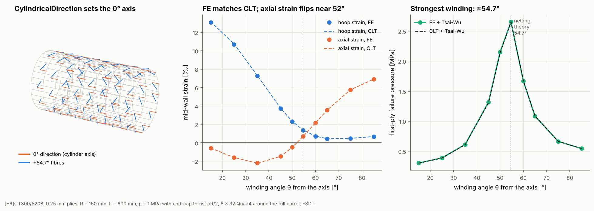

# 18 · Filament-wound pressure vessel: material orientation on a cylinder

A closed-end cylinder under internal pressure p carries a hoop resultant pR and
an axial resultant pR/2. Netting theory says a [±θ] winding carries this ratio
best at tan²θ = 2, so θ = 54.7° from the axis. This example meshes the full
barrel, sweeps the winding angle, and checks strains and first-ply failure
against classical lamination theory (CLT).



## The model

| Item | Value |
|---|---|
| Laminate | [θ/−θ/−θ/θ] T300/5208, 0.25 mm plies (1 mm wall) |
| Barrel | R = 150 mm, L = 600 mm, full 360°, 8 × 32 Quad4 (`CylindricalPanelBuilder`) |
| Material axis | `CylindricalDirection(reference="axial")`: 0° along the cylinder axis |
| Loads | internal pressure p = 1 MPa, end-cap thrust pR/2 as a line load on one end |
| Supports | axial restraint at the other end, plus three point restraints against rigid-body motion |
| Failure | Tsai-Wu first-ply failure at the ply mid-planes |

```bash
python examples/18_pressure_vessel_winding/pressure_vessel_winding.py
```

## Walkthrough

1. **Mesh the barrel and orient the plies.** On a curved shell each element has
   its own plane, so a fixed global vector cannot describe "along the axis"
   everywhere. `CylindricalDirection` gives each element the projection of the
   cylinder axis onto its plane:

   ```python
   named = CylindricalPanelBuilder(R, L, 8, 32, 0.0, 360.0).build_named(
       lam, FSDTModel(), material_axis=CylindricalDirection(reference="axial"))
   ```

   `reference="hoop"` measures angles from the circumferential direction instead,
   and `FieldDirection(f)` takes any function of position.

2. **Load it.** Element normals point outward, so a positive pressure is internal
   pressure. The end-cap thrust is a line load on the `x1` node set:

   ```python
   loads = LoadCase().add_pressure(P)
   loads.add_line_load(named.nodes("x1"), (P * R / 2, 0.0, 0.0))
   ```

3. **Compare with CLT.** Away from the ends the wall is in a uniform membrane
   state, so ε = A⁻¹ N with N = (pR/2, pR, 0) is exact.

## Reading the figure

- **Left:** the 0° direction (orange) follows the cylinder axis on every
  element, and the outer-ply fibres (blue) wind at 54.7° to it.
- **Middle:** the FE mid-wall strains match CLT within about 1% for hoop strain
  and 4% for axial strain. Near 50° the axial strain is a small difference of
  two large terms, so small discrepancies show up more there. Below about 52°
  the barrel shortens axially; above it, it lengthens.
- **Right:** the first-ply failure pressure peaks at ±54.7° (2.65 MPa), more
  than four times the ±35° value. FE and CLT agree to within 1%. This is a
  first-ply (matrix cracking) pressure, not the burst pressure, which needs a
  progressive damage analysis.

| θ | hoop ε FE | hoop ε CLT | axial ε FE | axial ε CLT | FPF pressure [MPa] |
|---|---|---|---|---|---|
| 35° | 7.26e−3 | 7.31e−3 | −2.20e−3 | −2.21e−3 | 0.61 |
| 54.7° | 1.37e−3 | 1.38e−3 | 0.71e−3 | 0.69e−3 | 2.65 |
| 75° | 0.47e−3 | 0.48e−3 | 5.76e−3 | 5.75e−3 | 0.66 |

## Things to try

- Use `reference="hoop"` and angles measured from the hoop direction (90 − θ):
  the results do not change.
- Add a hoop ply `[90, θ, −θ, −θ, θ, 90]` and watch the optimum move.
- Run `ProgressiveDamageAnalysis` at ±54.7° for the pressure after first-ply
  failure.
