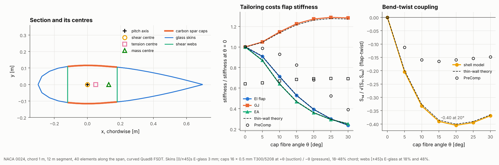

# 20 · Blade beam properties and bend-twist tailoring

Aeroelastic codes model a blade or wing as a beam. They need, at each station,
the section's stiffness matrix, its shear and tension centres and its mass per
length. This example extracts all of them from a shell model of a blade segment,
then turns the spar cap fibres off-axis to couple flap bending to twist, the
mechanism behind load-alleviating, bend-twist-coupled blades.



## The model

| Item | Value |
|---|---|
| Section | NACA 0024, 1 m chord, pitch axis at 30% chord |
| Segment | 12 m prismatic (12 chords), curved Quad8 FSDT (the default), 40 elements along the span |
| Skins | E-glass/epoxy [0/45/−45]s, 0.5 mm plies (3 mm) |
| Spar caps | 16 × 0.5 mm T300/5208 at 18–48% chord, at +θ on the suction side and −θ on the pressure side |
| Webs | E-glass/epoxy [±45]s at 18% and 48% chord |
| Sweep | θ = 0° to 30° in 5° steps |
| References | thin-walled beam theory (`_shared/thin_wall.py`); PreComp on the same section (`data/precomp_reference.json`) |

```bash
python examples/20_blade_beam_properties/blade_beam_properties.py
```

## Walkthrough

1. **Building the section.** Two stations with the same airfoil make a prismatic
   segment. Regions and webs are given by chord fraction; laminates are given by
   region name, with `_ss` and `_ps` suffixes when the suction and pressure sides
   differ:

   ```python
   REGIONS = [SkinRegion("le_panel", 0.0, 0.18, 4), SkinRegion("spar_cap", 0.18, 0.48, 6),
              SkinRegion("te_panel", 0.48, 1.0, 8)]
   WEBS = [ShearWeb("web_fwd", 0.18, 4), ShearWeb("web_aft", 0.48, 4)]
   blade = BladeBuilder(stations, REGIONS, WEBS, n_span=20).build(
       {"le_panel": skin, "te_panel": skin, "web_fwd": web, "web_aft": web,
        "spar_cap_ss": cap(+theta), "spar_cap_ps": cap(-theta)}, FSDTModel())
   ```

2. **Beam properties.** `beam_section_properties(blade)` clamps the root, closes
   the tip with a rigid end rib (an RBE2 on the translations) and applies unit axial
   force, two bending moments and a torque there. Two distributing links (RBE3) in
   the middle fifth of the span, clear of the root and tip, measure the mean
   section strains and curvatures. Inverting the 4 × 4 compliance gives the
   stiffness matrix about the pitch axis, couplings included:

   ```python
   props = beam_section_properties(blade)
   props.stiffness            # [N, Mx, My, Mz] against [axial strain, flap, edge curvature, twist rate]
   props.EI_x, props.GJ, props.shear_centre, props.tension_centre, props.mass_per_length
   props.bend_twist_coupling  # S14 / sqrt(S11 S44) for flap, and for edge
   ```

   Two tip shear loads then locate the shear centre (the twist each causes, less
   the twist its bending moment causes through the coupling terms).

3. **Segment length.** The clamp at the root and the rib at the tip stop the
   section warping, and the properties are measured where that restraint has died
   out. For off-axis caps it dies out slowly: on a 6 m segment the ±20° caps read
   EI flap 9% and the coupling 23% too high. At 12 m the answers no longer change
   (18 m gives the same to 0.2%).

4. **Thin-walled beam theory.** `_shared/thin_wall.py` computes the same 4 × 4
   stiffness the classical way: each skin and web segment is a laminate wall
   (its A matrix, hoop stress free) at its mid-thickness, the shear flows in the
   three cells follow from Bredt-Batho compatibility, and the section forces from
   the wall forces. It is exact in the thin-wall limit for a long segment with
   free warping, and it knows nothing about the shell model.

5. **PreComp.** `data/prepare_precomp_reference.py` runs NREL's PreComp (WISDEM's
   Python port) on the same section: the NACA 0024 profile, the same sectors on
   each surface, the same laminae and webs, the library materials' E1, E2, G12,
   ν12 and density. Its output is committed, so the example does not need WISDEM.

## Reading the figure

At θ = 0 (all about the pitch axis, except EI edge about the tension centre):

| | Shell model | Thin-walled beam | PreComp |
|---|---|---|---|
| EA [N] | 9.763e8 | 9.798e8 | 9.792e8 |
| EI flap [N m²] | 1.152e7 | 1.158e7 | 1.157e7 |
| EI edge [N m²] | 2.122e7 | 2.136e7 | 2.126e7 |
| GJ [N m²] | 1.730e6 | 1.727e6 | 1.109e6 |
| Tension centre aft of the pitch axis | 51.1 mm | 51.0 mm | 50.9 mm |

Over the cap-angle sweep:

| θ | EI flap: shell / thin wall / PreComp [N m²] | GJ: shell / thin wall / PreComp [N m²] | Flap-twist coupling: shell / thin wall / PreComp |
|---|---|---|---|
| 0° | 1.152e7 / 1.158e7 / 1.157e7 | 1.730e6 / 1.727e6 / 1.109e6 | 0 / 0 / 0 |
| 10° | 8.21e6 / 8.23e6 / 1.07e7 | 1.98e6 / 1.97e6 / 1.16e6 | −0.332 / −0.327 / −0.159 |
| 20° | 4.52e6 / 4.53e6 / 7.82e6 | 2.20e6 / 2.18e6 / 1.19e6 | −0.405 / −0.401 / −0.159 |
| 30° | 2.74e6 / 2.74e6 / 4.49e6 | 2.22e6 / 2.20e6 / 1.20e6 | −0.369 / −0.366 / −0.149 |

The skins are meshed on their mid-surface (the `BladeBuilder` default). Thin-wall
theory and PreComp take each wall's length on the outer mould line, which is a
little longer than the mid-wall length, so they read EA and EI 0.4–0.7% above the
shell model at 0°. With the skins left on the mould line and offset
(`mesh_surface="outer"`), the shell model counts the same mould-line length and
matches thin-wall EA and EI exactly, but its curved Quad8 facets then lose 1.6% of
GJ (example 26).

- **Left:** the section with its centres. The tension centre (51 mm aft of the
  pitch axis) sits where the carbon caps put it, the mass centre further aft
  (129 mm), pulled back by the long trailing-edge skin. The section weighs
  17.4 kg/m. The shear centre lands within a millimetre of the pitch axis.
- **Middle:** turning the cap fibres costs axial and flap stiffness fast (EI
  flap falls to 0.39 of its 0° value at 20°) and gains torsional stiffness (GJ
  rises by about 27%). The shell model and thin-walled beam theory agree within
  0.7% in EA and EI at every angle (the mould-line length above), and within 1% in
  GJ.
- **Right:** the bend-twist coupling coefficient S₁₄/√(S₁₁S₄₄). With +θ on one
  cap and −θ on the other, flap bending shears the two caps in opposite
  directions, and the closed section turns that into twist. The coupling peaks at
  about −0.40 near 20° and falls beyond as the caps lose stiffness. Shell and
  thin-wall theory agree within 1.5%.
- **PreComp agrees at 0° in EA, EI and the tension centre (within 0.5%) but not
  in torsion or coupling.** Its GJ is 35% below the other two, and with off-axis
  caps it keeps far more flap stiffness (0.68 of the 0° value at 20°, against
  0.39) and gives less than half the coupling. This matches example 24, where
  PreComp's GJ falls to half the published value outboard, and the published
  comparisons of section tools, which single out PreComp's torsion and coupling
  terms as its weakest outputs. For bend-twist-coupled designs, use the shell
  model (or thin-wall theory) rather than PreComp.

## Things to try

- Set the same angle on both caps (`cap(theta)` on both sides) and read the
  extension-twist term `stiffness[0, 3]`.
- Move the webs or widen the caps and watch the shear centre move.
- Shorten the segment to 6 m (`LENGTH = 6.0`, `N_SPAN = 20`) and watch the
  coupled properties drift away from thin-wall theory.
- Build a prismatic segment for each station of a tapered blade and tabulate the
  properties along the span, as input for an aeroelastic code.
