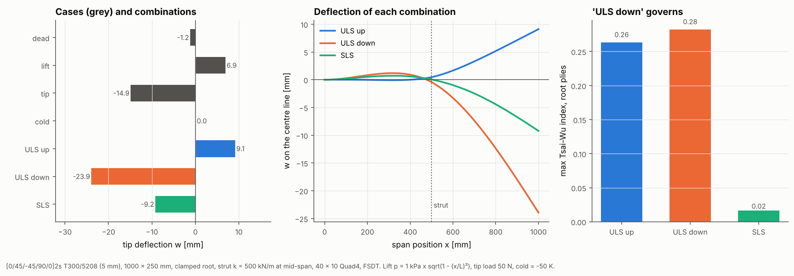

# 20 · Load cases and combinations

Design checks need many load cases and factored combinations of them. This
example applies the four kinds of distributed load the solver supports to a
propped cantilever panel, solves all cases with one factorisation, and forms
design combinations by superposition.



## The model

| Item | Value |
|---|---|
| Laminate | [0/45/−45/90/0]2s T300/5208, 0.25 mm plies (5 mm) |
| Panel | 1000 × 250 mm, 40 × 10 Quad4, FSDT |
| Supports | root clamped, strut at mid-span as a grounded spring k = 500 kN/m |
| `dead` | self-weight, `add_body_load((0, 0, -9.81))` |
| `lift` | elliptic pressure p = 1 kPa · √(1 − (x/L)²), a callable |
| `tip` | 50 N on the tip edge, `add_line_load` |
| `cold` | uniform ΔT = −50 K |

```bash
python examples/20_load_combinations/load_combinations.py
```

## Walkthrough

1. **Supports.** `add_spring` adds a grounded spring to any DOF, here the strut:

   ```python
   bcs = BoundaryConditions().clamp(named.nodes("left"))
   bcs.add_spring([strut], [DOF.UZ], 5.0e5)
   ```

   `fix_direction(nodes, direction)` gives skew supports in the same way.

2. **Load cases.** Each case is a `LoadCase` with a name:

   ```python
   LoadCase("dead").add_body_load((0.0, 0.0, -9.81))
   LoadCase("lift").add_pressure(lambda x: P0 * np.sqrt(max(0.0, 1.0 - (x[0] / SPAN) ** 2)))
   LoadCase("tip").add_line_load(named.nodes("right"), (0.0, 0.0, -TIP / CHORD))
   LoadCase("cold").set_hygrothermal(HygrothermalState(-50.0))
   ```

   The body load uses each ply's density (ρ·t summed through the stack). With an
   offset reference surface it also adds the moment of the weight about it.

3. **Solve once, combine.** `solve_many` assembles and factorises the stiffness
   matrix once and back-substitutes for each case. `solve_combinations` adds the
   factored results, which is exact for a linear analysis:

   ```python
   combos = [LoadCombination("ULS down", {"dead": 1.35, "tip": 1.5, "cold": 1.0}), ...]
   results = solver.solve_combinations(mesh, bcs, load_cases, combos)
   ```

   The script checks "ULS up" against a direct solve of the combined load: the
   largest difference is about 1e−9 of the peak displacement.

## Reading the figure

- **Left:** the strut takes most of the load, so the tip load (14.9 mm) moves
  the tip more than the lift does (6.9 mm). `cold` gives no deflection because
  the laminate is symmetric; its effect is the residual ply stress.
- **Middle:** the strut pins the deflection near zero at mid-span, so the inboard
  half bends the opposite way to the outboard half.
- **Right:** the highest Tsai-Wu index in the root plies. Both ULS combinations
  include the −50 K residual stress, which is why they are close (0.26 and
  0.28) and why the service case without it is far lower (0.02).

## Things to try

- Drop the strut (`STRUT_K = 0`) and watch the root moments rise.
- Add an `offset` to the laminate (`lam.with_offset(h / 2)`) to put the reference
  surface on the outer face, as for a skin bonded to a frame.
