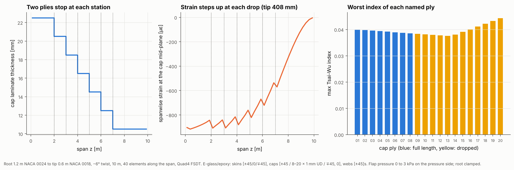

# 21 · Spar cap ply drops from a ply book

A real spar cap is not one laminate: it is a stack of named plies, each laid over
part of the blade, and the cap thins towards the tip as plies stop. This example
builds a tapered, twisted blade segment with `BladeBuilder`, then rebuilds its
spar caps ply by ply from a ply book (`Layup`), the way the laminate schedule of a
blade is written. Every element gets the stack of the plies that cover it, and
results come back per named ply.



## The model

| Item | Value |
|---|---|
| Geometry | 10 m segment, root 1.2 m NACA 0024, tip 0.6 m NACA 0018, −6° twist, pitch axis at 35% chord |
| Regions | LE panel 0–20% chord, spar cap 20–50%, TE panel 50–100%, webs at 20% and 50% |
| Mesh | Quad4 FSDT, 40 elements along the span |
| Skins | E-glass/epoxy [45/−45/0/−45/45], 0.5 mm plies |
| Webs | E-glass/epoxy [45/−45]s |
| Spar caps | ply book: inner skin [±45], 8 full-length UD plies, 12 more UD plies stopping in pairs at 2, 3, 4, 5, 6 and 7 m, outer skin [∓45/0] |
| Load | flap pressure on the pressure side, 0 at the root to 3 kPa at the tip |
| Supports | root clamped |

```bash
python examples/21_spar_cap_ply_drops/spar_cap_ply_drops.py
```

It takes about two and a half minutes, most of it writing the ply-by-ply VTK file.

## Walkthrough

1. **Blade geometry.** Stations give the chord, airfoil, twist and pitch axis along
   the span; the builder interpolates between them. Skin regions are chordwise
   bands and webs sit at chord fractions:

   ```python
   stations = [Station(0.0, 1.2, Airfoil.naca4("0024"), pitch_axis=0.35),
               Station(10.0, 0.6, Airfoil.naca4("0018"), twist=-6.0, pitch_axis=0.35)]
   blade = BladeBuilder(stations, REGIONS, WEBS, n_span=40).build(laminates, FSDTModel())
   ```

   Skin normals point outwards and the skin laminates grow inwards from the outer
   mould line (`skin_reference="outer"`). The 0° direction follows the span.

2. **The ply book.** Each `PlyDefinition` names a ply, its material, thickness and
   angle, the element set it lies on, and optionally a region function that cuts
   it short. Plies are listed from the inside out and the outer mould line stays
   fixed (`reference="top"`):

   ```python
   PlyDefinition("cap_12", glass, 1.0e-3, 0.0, elements="spar_cap", region=lambda x: x[2] < 4.0)
   layup = Layup(plies, name="cap", reference="top")
   layup.apply(mesh, blade.element_sets, element_ids=blade.elements("spar_cap"))
   ```

3. **Checking the schedule.** `layup.drops(...)` lists every element edge where a
   ply stops (144 here, both caps), `check_drops(max_per_step=2)` flags edges where
   more plies stop at once than allowed, and `ply_table(...)` gives the area and
   mass of each ply (163 kg of cap).

4. **Results per ply.** After the solve, `layup.ply_failure(solution, TsaiWuCriterion())`
   returns the highest index of each named ply and where it occurs.

5. **ParaView.** `write_vtu(..., layered=True)` writes the shell model and a second
   file with one cell per ply, offset through the thickness, so the ply drops can
   be seen and coloured by failure index.

## Reading the figure

- **Left:** the cap steps from 22.5 mm to 10.5 mm in six 2 mm steps.
- **Middle:** the spanwise strain at the mid-plane of the suction-side cap. Between
  drops it falls towards the tip with the bending moment; at each drop the cap
  loses two plies and the strain steps up by about 8%. The tip deflects 408 mm.
  (The strain is taken at the cap's own mid-plane. The shell reference surface is
  the outer face, and the mid-plane steps inwards at every drop, so strains at the
  reference surface mix in local bending from that step.)
- **Right:** the worst Tsai-Wu index of each cap ply. The full-length plies peak
  at the root. The dropped plies that run furthest out score highest, because
  the cap they end in is thinner for its bending moment. All are low at this load (the highest index in the cap
  stack, 0.12, is in the outer ±45 skin ply at the root).

## Things to try

- Stop more plies at once and see `check_drops` flag the edges.
- Turn the cap plies to ±5° on one side (`angle=5.0`) for bend-twist coupling.
- Open `vtk/blade_plies.vtu` in ParaView, threshold on `failure_index`, and
  scale the ply thickness with `thickness_scale` to see the drops.
