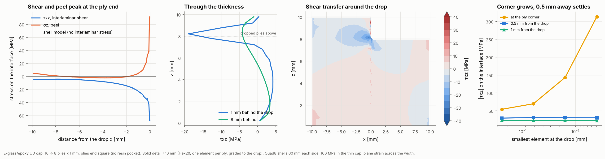

# 22 · Interlaminar stresses at a spar-cap ply drop

Spar caps taper towards the tip by stopping plies. A shell model sees only a step
in membrane stress where a ply ends, but the load in the dropped plies has to
shear across into the plies that carry on, and the interlaminar shear and peel
at the ply end are what start delaminations. This example puts a layered-solid
detail of the drop inside a shell model of the cap, the usual global-local
approach, without a separate submodel.



## The model

| Item | Value |
|---|---|
| Cap | E-glass/epoxy UD, 1 mm plies, 10 plies stepping to 8 (2 plies dropped, square ends, no resin pocket) |
| Solid detail | ±10 mm about the drop, Hex20 (20-node bricks), one element per ply, graded towards the drop |
| Shells | Quad8 FSDT, 60 mm of thick cap on the left and of thin cap on the right |
| Coupling | `couple_shell_to_solid` at both shell–solid joins, every shell node paired |
| Supports | left end clamped, right end gripped (no end rotation), plane strain across the 10 mm width |
| Load | 100 MPa tension in the thin cap, as a line load on the right end |

```bash
python examples/22_ply_drop_solid_detail/ply_drop_solid_detail.py
```

The main model has 552 elements and about 20 000 DOFs; with the mesh study the script takes about a minute.

## Walkthrough

1. **Two solid blocks, merged.** `solid_block` meshes a laminate as layered solids,
   one element per ply, with node and element sets (`x0`, `x1`, `top`, `ply3`, ...).
   Spacing along x is graded with node fractions so the elements are smallest at the
   drop. The thick and thin blocks share the face at x = 0 below the dropped plies;
   `merge_coincident_nodes` joins them there and renumbers the blocks' node sets:

   ```python
   a = solid_block(mesh, thick, L_SOLID, WIDTH, graded(14, 1), 2, origin=(-L_SOLID, 0, 0.5 * thick.thickness), element="hex20")
   b = solid_block(mesh, thin, L_SOLID, WIDTH, graded(14, 0), 2, origin=(0, 0, 0.5 * thin.thickness), element="hex20")
   merged = merge_coincident_nodes(mesh, a, b)
   ```

   The end faces of the dropped plies (x = 0, z = 8 to 10 mm) stay free.

2. **Shells either side.** Quad8 shell strips carry the cap away from the drop. Each
   shell edge is tied to the solid face beside it, so the shell node's translations
   and rotations drive the solid nodes above and below it:

   ```python
   couple_shell_to_solid(mesh, bcs, left["right"], a.nodes("x0"))
   couple_shell_to_solid(mesh, bcs, right["left"], b.nodes("x1"))
   ```

   Quad8 shells pair with Hex20 faces (both have mid-edge nodes); every shell node on
   the join must find a partner, or the join would act as a hinge.

3. **Stresses in the solids.** `stress_at(u, xi, eta, zeta)` on a solid element gives
   the full 3D stress at any point, here along the interface under the dropped plies
   and through the thickness. τxz is `stress_global[4]`, σz `stress_global[2]`.

## Checks

| Check | Model | Hand calculation |
|---|---|---|
| Mean σx 9 mm behind the drop (10 plies) | 80.03 MPa | 100 × 8/10 = 80.00 MPa |
| Mean σx 9 mm ahead of the drop (8 plies) | 100.06 MPa | 100.00 MPa |
| Interface shear integrated from the solid's end to the drop | 102.6 kN/m | axial force in the dropped plies there: 99.5 kN/m |

The last line is equilibrium of the two dropped plies: their end is free, so
every newton they carry at the start of the solid detail must cross the
interface below them before the drop. The 3% gap is the shear read on the
element face, where a displacement-based solid is least accurate. The dropped
plies carry 99.5 kN/m there rather than the 160 kN/m of a uniformly stressed cap,
because the mid-plane steps down at the drop and the gripped cap bends.

## Reading the figure

- **First panel:** along the interface under the dropped plies, shear and peel
  are small 10 mm from the drop and climb steeply over the last 2 mm. The two
  dropped plies hand their load to the plies below through this short zone:
  their force falls from 77 kN/m 5 mm behind the drop to 36 kN/m 1 mm behind it.
  The script prints peaks of −68 MPa shear and 92 MPa peel for 100 MPa in the
  thin cap.
- **Second panel:** 1 mm behind the drop the shear is concentrated at the
  interface under the dropped plies (about −19 MPa there). 8 mm behind it the
  profile is the smooth one a shell with equilibrium recovery would give.
- **Third panel:** the shear field around the ply end. The dropped plies (top
  left) shed their load into the cap within a few ply thicknesses of the end.
  The shell model has no interlaminar stress at all here.
- **Fourth panel: the mesh study.** A square-ended ply on a sharp corner is a
  stress singularity, so the corner value has no converged answer:

  | Smallest element | τxz at the corner | 0.5 mm away | 1 mm away | Peel at the corner |
  |---|---|---|---|---|
  | 0.25 mm | −54 MPa | −29.7 MPa | −22.7 MPa | 58 MPa |
  | 0.063 mm (the main model) | −70 MPa | −31.2 MPa | −22.7 MPa | 95 MPa |
  | 0.016 mm | −143 MPa | −30.7 MPa | −22.7 MPa | 208 MPa |
  | 0.004 mm | −313 MPa | −30.5 MPa | −22.6 MPa | 650 MPa |

  The corner value grows without bound as the mesh is refined, while the shear
  0.5 mm and 1 mm from the drop settles within 2% on the first mesh. Judge a
  drop by the stress a short distance away (a point or average stress
  criterion, with the distance calibrated to tests), not the corner value. At
  31 MPa, 0.5 mm away, this drop is within the 40–70 MPa interlaminar shear
  strength of glass/epoxy at 100 MPa cap stress.

## Things to try

- Taper the ply ends: replace the square end with a short resin wedge (a third
  `solid_block` with a resin `MaterialCard`) and watch the peel fall.
- Drop one ply instead of two (`N_DROP = 1`), or stop the plies in the middle of the
  stack instead of the outside.
