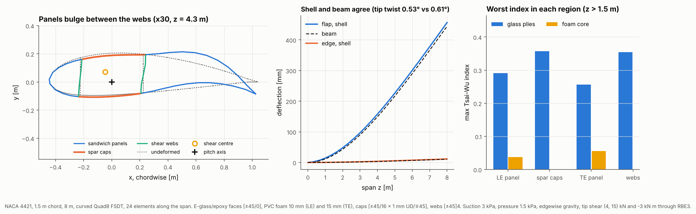

# 23 · Sandwich blade segment, checked against a beam

A segment of a wind or tidal turbine blade with the usual structure: foam-cored
sandwich panels at the leading and trailing edges, UD spar caps and two shear
webs. It is loaded the way a segment cut from a blade is loaded (surface
pressures, gravity, and the shear and torque of the blade outboard of it), and the
shell model is checked against a beam built from its own section properties.



## The model

| Item | Value |
|---|---|
| Section | NACA 4421 (cambered), 1.5 m chord, pitch axis at 30% chord |
| Segment | 8 m prismatic, curved Quad8 FSDT (the default), 24 elements along the span |
| Regions | LE panel 0–15% chord, spar cap 15–45%, TE panel 45–100%, webs at 15% and 45% |
| Sandwich panels | E-glass/epoxy faces [45/−45/0] and [0/−45/45], 0.5 mm plies; PVC foam (E = 85 MPa) 10 mm in the LE panel, 15 mm in the TE panel |
| Spar caps | [±45 / 16 × 1 mm UD / ∓45] E-glass/epoxy |
| Webs | [±45]4 E-glass/epoxy, 4 mm |
| Surface loads | 3 kPa suction, 1.5 kPa pressure |
| Gravity | edgewise, towards the leading edge (blade horizontal) |
| Outboard blade | 4 kN edge and 15 kN flap shear, −3 kN m torque, on a reference node tied to the tip by an RBE3 |
| Supports | root clamped |

```bash
python examples/23_blade_segment/blade_segment.py
```

It takes about two minutes, most of it writing the ply-by-ply VTK file.

## Walkthrough

1. **Sandwich laminates.** A foam core is one more ply with its own `MaterialCard`:

   ```python
   sandwich = Laminate(face_out + [Ply(FOAM, 15e-3, 0)] + face_in)
   ```

   FSDT treats the sandwich as one equivalent layer with a shear correction, which
   is fine for global stiffness; example 09 compares it with zig-zag and layerwise
   theories, which resolve the soft core.

2. **Loads.** Pressure acts along each element's outward normal, so suction on the
   suction side is positive and pressure on the pressure side negative. Gravity is
   a body load that uses each ply's density. The outboard blade's loads go on a
   reference node at the pitch axis, tied to the tip section by a distributing link
   (RBE3). Unlike a rigid link, it loads the tip without stiffening the section:

   ```python
   tip = add_reference_node(mesh, (0.0, 0.0, LENGTH))
   distributing_link(mesh, bcs, tip, blade.nodes("tip"))
   load.add_nodal_load(tip, 1, 15e3).add_nodal_load(tip, 5, -3e3)
   ```

   Unloaded distributing links at every section are pure measuring points: their
   displacements are the mean translation and rotation of the section, which is
   what a beam model predicts.

3. **The beam check.** `beam_section_properties` gives the 4 × 4 section stiffness
   and the shear centre from the same shell model. The script sums the distributed
   load per unit length from the mesh (pressure × area × normal, plus weight),
   forms the shear forces, bending moments and torque at each section, and
   integrates the beam's curvatures from the root. The torque about the shear
   centre, not the pitch axis, is what twists the section.

4. **Failure.** Ply stresses in each region are checked with Tsai-Wu, foam core
   and glass faces apart. The first chord length from the clamp is reported
   separately: there the clamp stops the section warping, a boundary layer that a
   real blade root, with its own flexibility, does not have.

## Reading the figure

- **Left:** the mid-span section, with its displacement less the rigid section
  motion, scaled 30 times. The section is not rigid: the TE sandwich panels, 0.8 m
  wide between the aft web and the trailing edge, bulge under the surface
  pressures by about 2 mm, and the trailing edge drops by 3 mm. A beam model
  assumes none of this.
- **Middle:** flap deflection reaches 457 mm in the shell and 444 mm in the beam
  (3% apart), edge deflection 11.6 mm and 10.7 mm. The beam leaves out shear
  deformation of the webs and the panel distortion, so it is slightly stiffer. Tip
  twist is 0.53° in the shell and 0.61° in the beam (13% apart): the clamp's
  warping restraint stiffens the shell in torsion near the root. (On the mould
  line with offset skins, the earlier default, the two were 11% apart.)
- **Right:** the worst Tsai-Wu index beyond the root boundary layer. The spar caps
  (0.36) and webs (0.35) carry the most; the panels are lower (0.26 to 0.28) and
  the foam cores lower still (0.04 to 0.06). In the first chord from the clamp the
  indices are 1.3 to 2.3 times higher (0.63 in the LE panel faces).

Open `vtk/blade_segment.vtu` in ParaView for the deformed shape and stress
resultants, and `vtk/blade_segment_plies.vtu` for each ply's failure index.

## Things to try

- Thin the TE core to 5 mm and watch the panel bulge grow.
- Replace the RBE3 at the tip with `rigid_link(mesh, bcs, tip, blade.nodes("tip"))`,
  an end rib, and compare the tip twist.
- Taper the segment (a smaller tip station) and load it with a spanwise pressure
  `lambda x: q * x[2] / LENGTH`.
- Swap `FSDTModel()` for `RefinedZigZagModel()` to resolve core shear in the
  panels.
