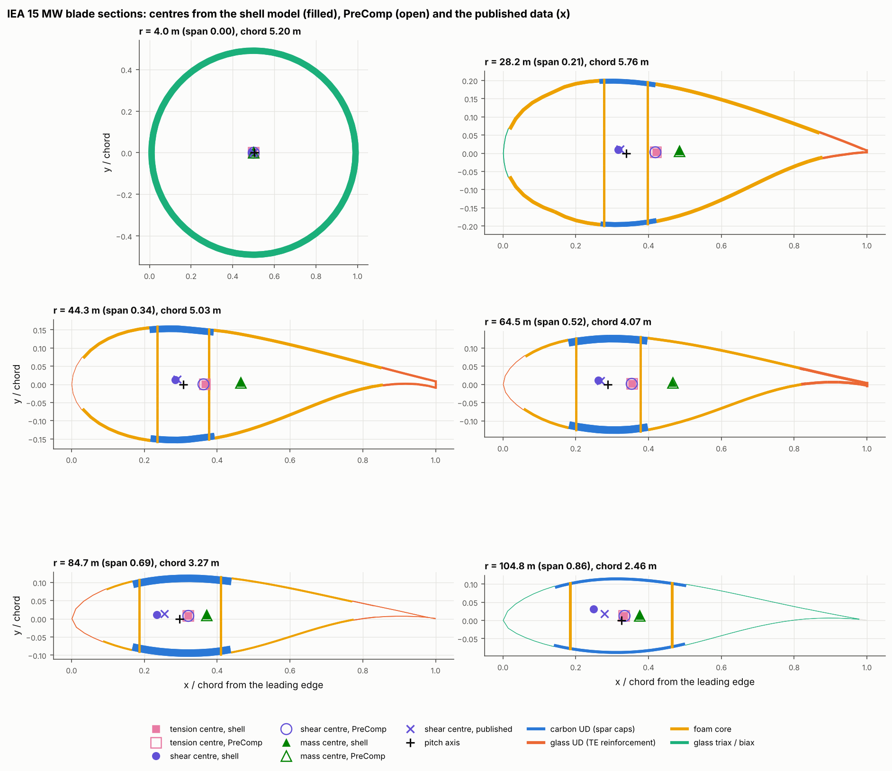
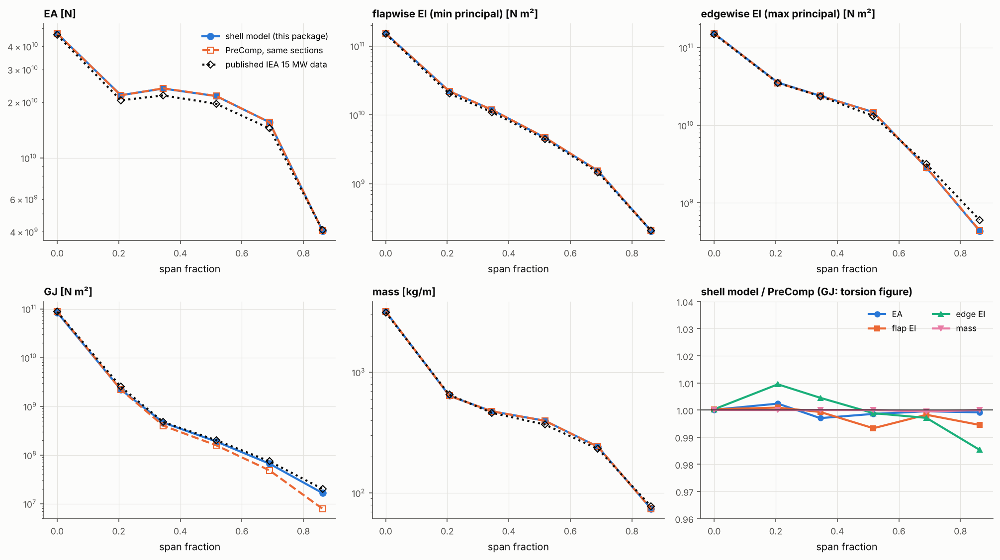
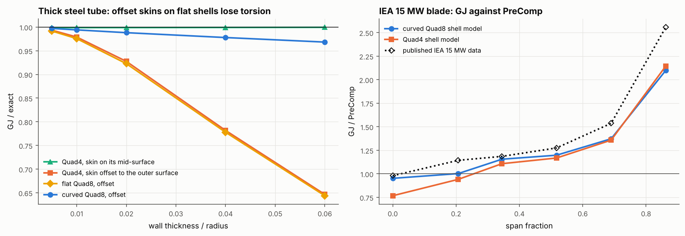

# 24 · IEA 15 MW blade: section properties against PreComp

Example 20 extracts beam properties from a shell model of an invented section.
This one checks them on a real blade. The IEA Wind 15 MW reference turbine
publishes its blade as a full layup, and its turbine models carry the beam
properties made from it. Six stations of that blade are rebuilt as shell models
and compared with PreComp, run on exactly the same sections, and with the
published data.







## The reference data

| Item | Value |
|---|---|
| Blade | IEA Wind 15 MW offshore reference turbine, 117 m blade ([IEAWindTask37/IEA-15-240-RWT](https://github.com/IEAWindTask37/IEA-15-240-RWT), `WT_Ontology/IEA-15-240-RWT.yaml`) |
| Stations | r = 4.0 m (root tube), 28.2 m (max chord, flatback), 44.3, 64.5, 84.7 and 104.8 m |
| Materials | Carbon UD spar caps, glass UD trailing-edge reinforcement, glass triax skins, glass biax webs, foam cores, gelcoat (the yaml's 2D orthotropic constants) |
| PreComp | WISDEM 4.2.8's Python port of NREL's PreComp |
| Published data | The `elastic_properties` 6 × 6 stiffness and mass data in the same yaml |

The NREL 5 MW blade was the other candidate. Its windIO file (in WISDEM's
examples) says its layup was changed for manufacturability and no longer
reproduces the published NREL 5 MW properties, so it cannot be checked like for
like. The IEA 15 MW file holds both the layup and the properties.

`data/iea15mw_sections.json` is committed, so the example needs neither WISDEM
nor a network connection. `data/prepare_reference_data.py` rebuilds it: it runs
WISDEM's blade model on the yaml, captures the PreComp inputs at each station
(airfoil points, sector boundaries on each surface, laminae per sector, web
positions), and re-runs PreComp with zero twist so its properties are in the
chord frame, for a prismatic segment.

## The model

| Item | Value |
|---|---|
| Segment | Prismatic, 8 chords long, properties measured over the middle fifth |
| Elements | Curved Quad8 FSDT, 32 along the span, chordwise size 1.5% of the perimeter (2300–3600 elements); a Quad4 model (40 along the span, 1%) for the torsion comparison |
| Skins | On the outer mould line, laminates growing inward, as PreComp has them |
| Regions | Every sector boundary on either surface and every web is a region boundary; each region takes its surface's sector laminate |
| Webs | Straight, between the skins' outer mould lines at the PreComp web positions, as PreComp has them |
| Trailing edge | Flatbacks closed by a web with the trailing-edge laminate; gaps under 1% of the chord are pinched closed |

```bash
python examples/24_iea15mw_section_properties/iea15mw_section_properties.py
```

It takes about 15 minutes (six curved-Quad8 and six Quad4 models).

## Walkthrough

1. **From PreComp sections to shell regions.** `examples/_shared/iea15mw.py`
   reads a station and builds the `BladeBuilder` inputs. PreComp places sectors
   by chord fraction on each surface separately, so the regions are the union of
   both surfaces' boundaries and the webs, and each region takes the laminate of
   the sector it falls in, per side (`sector3_ss`, `sector3_ps`). PreComp lists
   laminae from the outer surface inward; a `Laminate` runs from its bottom face
   (inside the section), so the order is reversed:

   ```python
   blade = build_segment(station, 8 * station["chord"], n_span=32, h_perimeter=0.015, element="quad8_curved")
   props = beam_section_properties(blade)
   ```

2. **Comparable numbers.** PreComp gives EA, the flap and edge stiffnesses and
   their coupling about the tension centre, GJ, and the tension, shear and mass
   centres. The shell model's 4 × 4 stiffness about the pitch axis is reduced to
   the tension centre the same way. The published 6 × 6 is Timoshenko (with
   shear), so its 4 × 4 compliance block is used (shear forces free, as in the
   shell extraction), and only frame-free numbers are compared: EA, the principal
   bending stiffnesses and GJ. Its axes turn out to be chord-aligned (its tension
   centre matches PreComp's at every station), so its shear centre is shown too.

3. **Torsion check.** A thick steel tube with a known GJ is run with the skin on
   its mid-surface and offset to its outer surface, on flat and curved shells.

## Results

| Station r [m] | EA | EI flap | EI edge | GJ | mass | tension centre x/c | shear centre x/c (shell / PreComp / published) |
|---|---|---|---|---|---|---|---|
| 4.0 | 1.000 | 1.000 | 1.000 | 0.952 | 1.000 | 0.500 / 0.500 | 0.494 / 0.500 / 0.500 |
| 28.2 | 1.002 | 1.001 | 1.010 | 1.003 | 1.000 | 0.420 / 0.420 | 0.317 / 0.418 / 0.322 |
| 44.3 | 0.997 | 0.999 | 1.005 | 1.155 | 1.000 | 0.367 / 0.366 | 0.285 / 0.362 / 0.290 |
| 64.5 | 0.999 | 0.993 | 0.999 | 1.198 | 1.000 | 0.355 / 0.355 | 0.262 / 0.353 / 0.268 |
| 84.7 | 1.000 | 0.998 | 0.997 | 1.372 | 0.999 | 0.320 / 0.320 | 0.234 / 0.320 / 0.255 |
| 104.8 | 0.999 | 0.994 | 0.985 | 2.098 | 1.000 | 0.332 / 0.333 | 0.249 / 0.333 / 0.279 |

Stiffness and mass columns are shell model / PreComp.

- **Axial, bending, mass, tension centre: agree.** EA, both bending stiffnesses
  and the mass are within 1.5% of PreComp at every station (mostly within 0.5%),
  and the tension and mass centres within 0.1% of the chord. Since the geometry,
  layup and materials are identical, this checks the section builder (airfoil,
  sector mapping, laminate order, offsets, webs) and the stiffness extraction.
- **Shear centre: follows the published data, not PreComp.** PreComp puts the
  shear centre on top of the tension centre at every station. The shell model
  puts it 8–10% of the chord further forward, between the webs, within 0.6% of
  the chord of the published value inboard and 2–3% outboard.
- **GJ: between PreComp and the published data, closer to the published.** At
  the root tube the shell model is 3% under the published GJ (the offset skin's
  area is taken on the outer surface, as in the tube check) and PreComp is 2%
  over it. Outboard, PreComp falls below half of the published GJ while the shell
  model stays within 3–18% of it. PreComp's torsion comes from a simplified
  thin-wall shear-flow model, and published comparisons with finite-element
  section tools (VABS, BECAS) report its torsional stiffness and shear centre as
  its least reliable outputs, which is what this shows.
- **The published data is not PreComp on this layup.** Its EA is up to 10% below
  PreComp's on the current yaml, so it was made with another tool or an earlier
  layup. It is a second reference here, not the like-for-like one.

### Offset skins on flat shells lose torsion

The torsion figure is the finding of this check. With the skin offset to the
outer surface, flat facets (Quad4 and flat Quad8) under-predict the torsional
stiffness of a thick tube: by 2% at t/R = 0.01, 7% at 0.02, 22% at 0.04 and 35% at
0.06, and refining the mesh does not help. With the skin on its mid-surface the
same Quad4 mesh is exact, and curved Quad8 with the offset is within 1–3% (the
rest is the offset skin's area, taken on the outer surface; EA is high by the
same amount). Bending and axial stiffness are not affected.

On the blade this costs the Quad4 model 20% of GJ at the root tube (t/R = 0.04)
and 6% at the max-chord station; elsewhere it is within 5% of curved Quad8. The
likely mechanism: at a kink between two flat facets, a node's rotation about its
own normal is a bending rotation for the neighbouring facets, and through the
offset it moves their mid-surfaces in-plane at little cost (the error grows as
the drilling stiffness is lowered). Curved Quad8 has a continuous normal and no
kinks. Until the flat elements are fixed, use `element="quad8_curved"` where
torsion of thick-walled sections matters; `tests/test_blade.py` records the
limitation as an expected failure.

## Things to try

- Add stations: edit `TARGETS` in `data/prepare_reference_data.py` and rerun it
  (needs `pip install wisdem pyyaml`).
- Set `QUAD4` as the main model to see the root-tube GJ fall.
- Compare the flap-edge coupling `EI_flap_edge` with PreComp's `EI_flap_edge`
  in the JSON, both in the chord frame.
