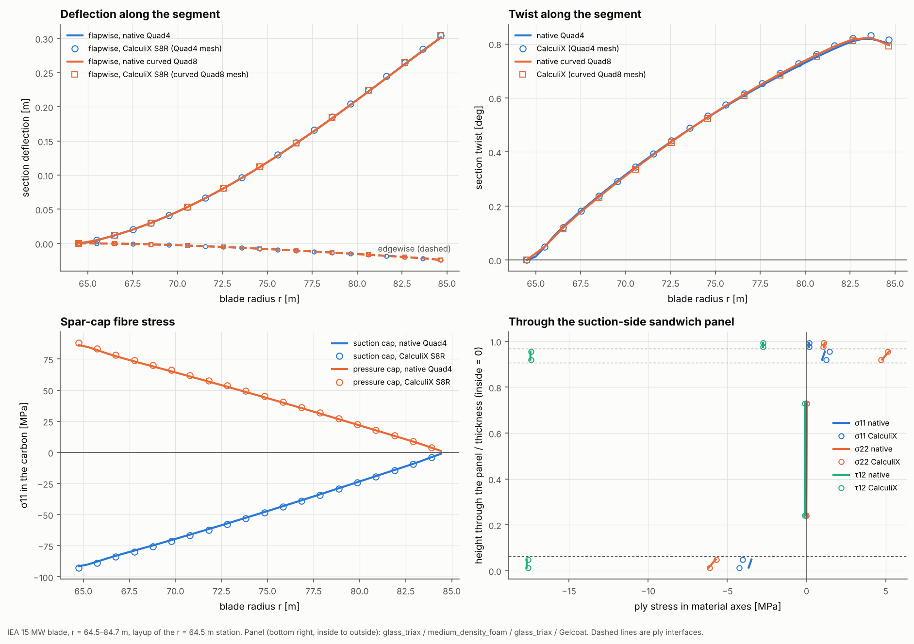

# 25 · CalculiX cross-check on a 20 m blade segment

Example 07 checks the native solver against CalculiX on a flat coupon. This one
does it at blade scale: a 20 m outboard segment of the IEA 15 MW reference blade,
with its published layup, under an operating-type load. The same analysis model
goes to both solvers, once meshed with Quad4 shells and once with curved Quad8.



## The model

| Item | Value |
|---|---|
| Segment | IEA 15 MW blade from r = 64.5 m to r = 84.7 m (20.2 m), chord 4.07 m to 3.27 m, published twist (1.5° to −0.4°) |
| Section | The r = 64.5 m station from example 24: FFA-W3 blend about 27% thick, 89 mm carbon spar caps (18–40% chord), 27 mm foam-cored glass panels, 30 mm glass UD trailing-edge reinforcement, two foam-cored webs, a 56 mm flatback trailing edge closed by a web |
| Layup | The same along the segment (the r = 64.5 m station's sectors and laminae), skins on the outer mould line |
| Meshes | Quad4 FSDT, 40 along the span (4840 elements); curved Quad8, 20 along the span (1460 elements) |
| Support | Root section clamped |
| Loads | Suction 1.7 kPa and pressure 0.8 kPa at the root, both rising 30% to the tip (about 10 kN/m flapwise); edgewise gravity; outboard shear at the tip, 250 kN flapwise on the web nodes and 60 kN edgewise on the skin nodes |

```bash
apt install calculix-ccx    # ccx on the PATH
python examples/25_blade_calculix_crosscheck/blade_calculix_crosscheck.py
```

Without `ccx` the script says so and stops. It takes about two minutes.

## Walkthrough

1. **The segment.** `examples/_shared/iea15mw.py` turns a station of the
   published blade (the PreComp sections of example 24) into `BladeBuilder`
   regions, webs and laminates. `build_segment` then tapers the chord and twists
   the section along the span:

   ```python
   blade = build_segment(ROOT, LENGTH, tip_chord=TIP["chord"], twist=(ROOT["twist_deg"], TIP["twist_deg"]),
                         element="quad4", n_span=40, h_perimeter=0.012)
   ```

2. **Loads.** Pressures are functions of position, so they rise along the span;
   suction acts along the outward normal on the suction side, pressure against it
   on the pressure side. Gravity is a body load. The outboard blade's shear goes on
   the tip nodes of the webs (flapwise) and of the skins (edgewise):

   ```python
   load = LoadCase("operating").add_body_load((-9.81, 0.0, 0.0))
   load.add_pressure(lambda x: 1.7e3 * (1 + 0.3 * x[2] / LENGTH), suction_side)
   load.add_pressure(lambda x: -0.8e3 * (1 + 0.3 * x[2] / LENGTH), pressure_side)
   ```

3. **Both solvers.** One `AnalysisModel` holds the mesh, supports, loads and the
   elements to report ply stresses for (both spar caps along the span, and one
   sandwich panel). `NativePythonKernelAdapter` and `CalculiXKernelAdapter` run it.
   CalculiX accepts composite shells only as S8R, so the Quad4 mesh is promoted to
   S8R with straight-sided mid-side nodes, and the curved Quad8 mesh is written
   node for node. CalculiX then expands every S8R into a 20-node brick with the
   plies inside it, so it treats the offset skins, the 95 mm thick caps, the
   web-to-skin joints and the flatback corners in 3D.

4. **Comparing.** Section deflection and twist come from the node translations
   of each mesh section (CalculiX does not print shell rotations): the mean
   translation, and the least-squares rotation about the span axis. Ply stresses
   are compared in material axes at two points per ply.

## Results

| | native | CalculiX S8R | difference |
|---|---|---|---|
| Tip flapwise deflection, Quad4 mesh | 301.5 mm | 304.6 mm | −1.0% |
| Tip edgewise deflection, Quad4 mesh | −24.3 mm | −24.4 mm | −0.4% |
| Tip twist, Quad4 mesh | 0.801° | 0.814° | −1.6% |
| Tip flapwise deflection, curved Quad8 mesh | 301.1 mm | 304.1 mm | −1.0% |
| Tip twist, curved Quad8 mesh | 0.795° | 0.791° | 0.5% |
| Flapwise displacement, every node (Quad4 mesh) | | | max 1.2% of the peak |
| Fibre stress in the suction cap at a quarter span | | | max 5.9% of the peak |
| σ22 and τ12 in the sandwich panel at a quarter span | | | max 1.0% of the peak |

Runtimes on one core: native 20 s, CalculiX 15 s for the Quad4 model (14,600 S8R
nodes after promotion).

- **Top left:** flapwise and edgewise deflection along the segment; the two
  solvers lie on top of each other for both meshes.
- **Top right:** twist. The flap load acts away from the shear centre and the
  segment twists by 0.8° over its length; the kink near the tip is where the tip
  forces go in on the web and skin nodes (the same nodal forces in both solvers).
  Native Quad4 and curved Quad8 agree with each other; CalculiX on the promoted
  Quad4 mesh (straight-sided S8R) twists 3% more than on the curved mesh.
- **Bottom left:** fibre stress in the carbon of both caps, about −90 MPa
  (suction side, compression) and +90 MPa at the root, falling to zero at the tip.
  The CalculiX values sit on the native curves.
- **Bottom right:** ply stresses through the suction-side sandwich panel at a
  quarter span: the glass faces carry the load and the foam core next to nothing.

The remaining differences come from the two element formulations (FSDT shells
with a shear correction factor against 3D bricks with reduced integration) and
from where the stresses are sampled. The transverse stress σ22 in the caps is
small (about 3 MPa against 90 MPa along the fibres), so its relative error is
large while the absolute error stays under 3 MPa.

## What the check found

Running a blade through CalculiX exposed a problem in the CalculiX deck writer,
fixed in this change. Body loads were written as nodal forces and moments (the
moments come from the skin offset). CalculiX turns moments on shell nodes into
mean-rotation equations, which it rejected at the clamped root ("zero
coefficient on the dependent side of an equation") and which turned some
expanded bricks inside out at the flatback corners. Body loads are now written as
`*DLOAD, GRAV`, which CalculiX integrates over the expanded bricks, so the
offsets and ply densities are included directly.

Clamped shell edges keep their rotation constraints. Without them CalculiX fixes
only the mid-surface node of each expanded shell node and the edge becomes a
hinge (a clamped curved panel in `tests/test_generality.py` then deflects 40%
more than the native solver).

## Things to try

- Swap the station: `ROOT, TIP = DATA["stations"][4], DATA["stations"][5]` runs the
  outboard r = 84.7–104.8 m segment, which has a sharp trailing edge.
- Add `CalculiXKernelAdapter(threads=4)` for a faster CalculiX solve.
- Monitor other elements (webs, the leading-edge panel) by adding them to
  `monitor_elements`.
