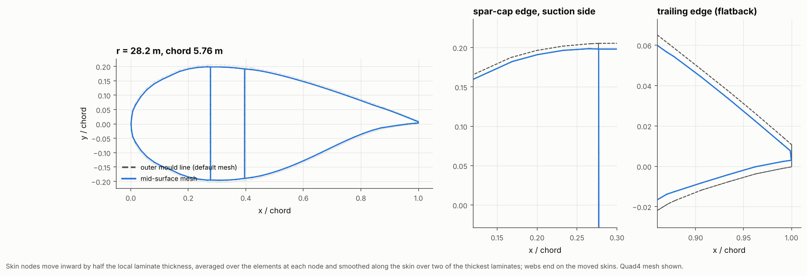
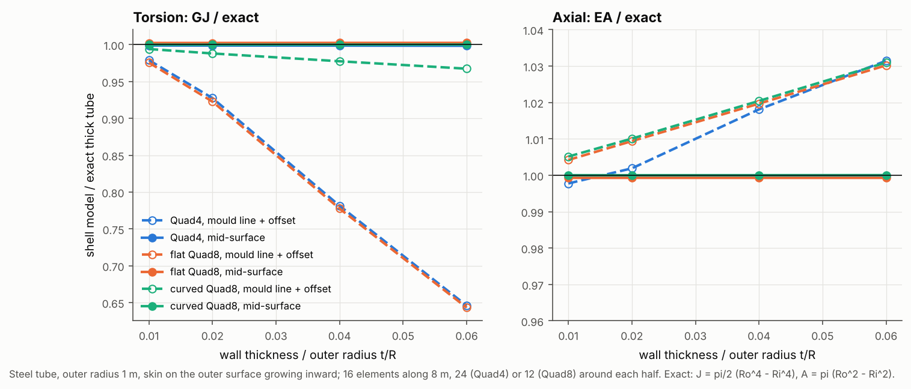
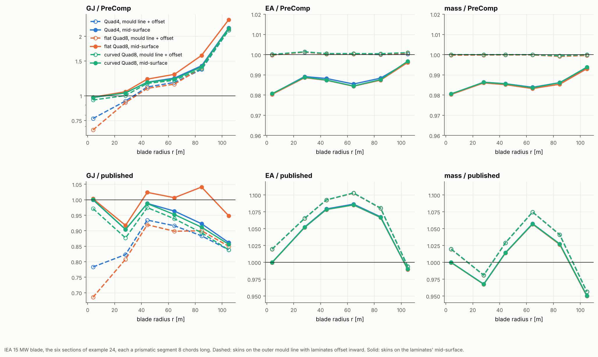

# 26 · Mould line with offsets, or mid-surface: two ways to mesh blade skins

`BladeBuilder` meshes the skins on the outer mould line (OML) by default and
offsets each laminate inward by half its thickness, as the laminate grows from the
mould. Example 24 found that flat shells (Quad4, flat Quad8) then lose torsional
stiffness in thick closed sections. `mesh_surface="mid"` is the other way: the skin
nodes move onto the laminates' mid-surface and the offsets go. This example runs
both on a thick tube with a closed-form answer, and on the six IEA 15 MW stations of
example 24 against PreComp and the published data. Each case runs with Quad4, flat
Quad8 and curved Quad8.







## How the mid-surface is made

```python
blade = BladeBuilder(stations, regions, webs, n_span=32, mesh_surface="mid").build(laminates, FSDTModel())

# or after a Layup with ply drops, from a mould-line mesh:
Layup(plies, reference="top").apply(blade.mesh, blade.element_sets, element_ids=blade.elements("spar_cap"))
blade = blade.to_mid_surface()
```

1. **Shift.** Every skin element knows where its plies are: its laminate offset
   (−t/2 for a skin on the mould line). The shift of each skin node is the
   area-weighted mean offset of the skin elements around it.
2. **Smoothing.** The shifts are averaged along the skin with a hat kernel over
   paths shorter than `mid_surface_smoothing`. By default that is two of the
   thickest skins: 0.2–0.5 m on these sections. This makes the surface step gently
   where the thickness changes: spar-cap edges, the trailing-edge reinforcement and
   ply drops.
3. **Move.** Each node moves along its section normal, which is the mean element
   normal projected into the cross-section plane. Root, tip and mesh sections stay
   in their planes.
4. **Offsets.** Each element keeps whatever offset still separates its plies from
   the moved surface. That is zero away from thickness changes, and small in the
   blends, so every ply stays where it was through the thickness.
5. **Webs.** The web nodes are re-spaced between their two joints, so the webs run
   between the skins' mid-surfaces.

A narrow element between skins of very different thickness can fold over if the
smoothing is too short. The builder then says so and asks for a longer
`mid_surface_smoothing`. With no smoothing at all, one IEA section had such an
element.

## The model

| Item | Value |
|---|---|
| Tube | Steel, outer radius 1 m, wall t inward from the outer surface, t/R = 0.01–0.06; 8 m long, 16 elements along, 24 (Quad4) or 12 (Quad8) around each half. Exact: J = π/2 (Ro⁴ − Ri⁴), A = π (Ro² − Ri²) |
| Blade | The six IEA 15 MW sections of example 24 (same airfoil points, sectors, laminae, materials), prismatic segments eight chords long |
| Meshes | Quad4: 40 along the span, 1% of the perimeter around. Flat and curved Quad8: 32 along, 1.5% around (as in example 24) |
| References | PreComp on the same sections; the published 6 × 6 and mass data |

```bash
python examples/26_mid_surface_meshing/mid_surface_meshing.py            # figures from data/results.json
python examples/26_mid_surface_meshing/mid_surface_meshing.py --rerun    # all 42 analyses, about 1.5 hours
```

## Results

### Thick tube

| GJ / exact | t/R = 0.01 | 0.02 | 0.04 | 0.06 |
|---|---|---|---|---|
| Quad4, mould line + offset | 0.979 | 0.927 | 0.781 | 0.646 |
| flat Quad8, mould line + offset | 0.976 | 0.923 | 0.778 | 0.643 |
| curved Quad8, mould line + offset | 0.994 | 0.988 | 0.977 | 0.967 |
| Quad4, mid-surface | 0.999 | 0.999 | 0.999 | 0.998 |
| flat Quad8, mid-surface | 1.002 | 1.002 | 1.002 | 1.002 |
| curved Quad8, mid-surface | 1.000 | 1.000 | 1.000 | 1.000 |

On the mid-surface, all three elements are exact to 0.2% in torsion and axial
stiffness. On the mould line, the flat elements lose up to 35% of GJ, and even
curved Quad8 is 3% low at t/R = 0.06.

The offset model also counts too much material, by the same amount on every
element. EA is 3% high at t/R = 0.06, because each element's plies keep the
element's area on the outer surface, and the outer circumference is longer than
the mid-wall one. The mid-surface has the right length: (outer perimeter − π t)
× t is the exact wall area of a closed convex section.

### IEA 15 MW stations

Curved Quad8 against PreComp and the published data:

| r [m] | GJ / PreComp, outer → mid | GJ / published, outer → mid | EA / PreComp, outer → mid | mass / published, outer → mid |
|---|---|---|---|---|
| 4.0 (root tube) | 0.952 → 0.981 | 0.972 → **1.001** | 1.000 → 0.981 | 1.020 → **1.000** |
| 28.2 (max chord) | 1.003 → 1.034 | 0.877 → 0.904 | 1.001 → 0.989 | 0.981 → 0.968 |
| 44.3 | 1.155 → 1.171 | 0.975 → 0.988 | 1.001 → 0.987 | 1.029 → 1.014 |
| 64.5 | 1.197 → 1.214 | 0.939 → 0.952 | 1.001 → 0.984 | 1.075 → 1.057 |
| 84.7 | 1.373 → 1.400 | 0.894 → 0.911 | 1.000 → 0.988 | 1.041 → 1.027 |
| 104.8 | 2.143 → 2.189 | 0.838 → 0.856 | 1.001 → 0.997 | 0.957 → 0.951 |

GJ / PreComp for each element:

| r [m] | Quad4 outer | Quad4 mid | flat Quad8 outer | flat Quad8 mid | curved Quad8 outer | curved Quad8 mid |
|---|---|---|---|---|---|---|
| 4.0 | 0.767 | 0.980 | 0.672 | 0.983 | 0.952 | 0.981 |
| 28.2 | 0.941 | 1.034 | 0.924 | 1.049 | 1.003 | 1.034 |
| 44.3 | 1.108 | 1.171 | 1.090 | 1.214 | 1.155 | 1.171 |
| 64.5 | 1.168 | 1.228 | 1.145 | 1.284 | 1.197 | 1.214 |
| 84.7 | 1.358 | 1.418 | 1.383 | 1.599 | 1.373 | 1.400 |
| 104.8 | 2.143 | 2.203 | 2.173 | 2.424 | 2.143 | 2.189 |

- **The mid-surface makes Quad4 as good as curved Quad8.** On the mould line,
  Quad4 is 20% below curved Quad8 in GJ at the root tube and 6% below at max chord.
  On the mid-surface, the two agree within 1.3% at every station, and within 0.1%
  at the root. EI and EA agree within 0.2%.
- **At the root tube, the mid-surface model matches the published data.** EA, both
  EIs, GJ and mass all agree within 0.3%. The mould-line model is 2% high in EA and
  mass there. The published data were made with a tool that integrates the true
  wall, while the offset shell model counts each laminate as mould-line length ×
  thickness. PreComp does the same: it agrees with the mould-line model in EA and
  mass to 0.1% everywhere, and with the exact annulus area only after the same
  1 − t/2R correction (0.981 at the root).
- **Outboard, the mid-surface moves GJ 1.5–3% towards the published values.** This
  happens at every station. It also moves EA and mass 1–2% below PreComp, for the
  wall-length reason above. The remaining differences from the published data
  (EA 5–9% low, GJ 5–14% low outboard) are as large as those between PreComp and
  the published data. Example 24 explains them: the published data do not come
  from the current layup.
- **Flat Quad8 on the mid-surface converges slowly around the section.** It
  matches the other elements at the root and on the tube. On the thin outboard
  sections, though, its GJ is 4–14% above Quad4 and curved Quad8. At r = 84.7 m,
  halving the chordwise element size brings it from 1.599 to 1.457 of PreComp,
  and doubling the spanwise elements instead brings it to 1.500, both towards
  curved Quad8's 1.400. A flat Quad8 projects its curved mid-side geometry
  onto one plane, which a thin, strongly curved section shows up. Use Quad4 or
  curved Quad8 on the mid-surface.

## Which to use

| | mould line + offset (default) | mid-surface |
|---|---|---|
| Torsion of thick sections, flat elements | 20–35% low | exact |
| Torsion, curved Quad8 | 2–5% low at the root | exact |
| Wall area (EA, mass) of thick curved walls | high by about t/2R, as in PreComp | exact |
| Outer geometry (pressures, contact, mould) | exact | inset by t/2 |
| Skin stresses at the mould surface | at the reference surface | through the ply stack as usual |
| Cost | | the same mesh |

Use the mid-surface for section properties and torsion, above all with Quad4. Keep
the mould line where the outer geometry matters, for example when comparing with a
CAD surface. To match PreComp like for like (example 24), the mould line is the
closer of the two, because PreComp makes the same thin-wall area assumption.

## Things to try

- Run the stations with `mid_surface_smoothing=0.05` to see the cap edges sharpen.
- Apply a spar-cap ply-drop `Layup` (example 21) to a mould-line blade, then call
  `blade.to_mid_surface()`. The cap's mid-surface steps up at each drop.
- Refine flat Quad8 around the section (`ELEMENTS["quad8"]`) and watch it close on
  curved Quad8.
