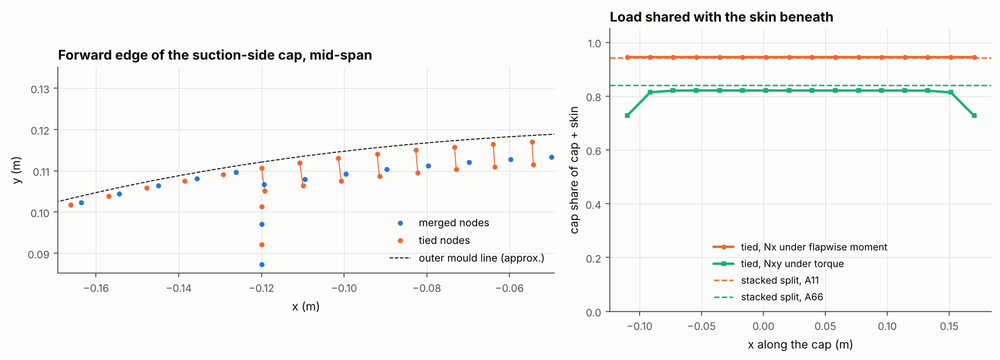
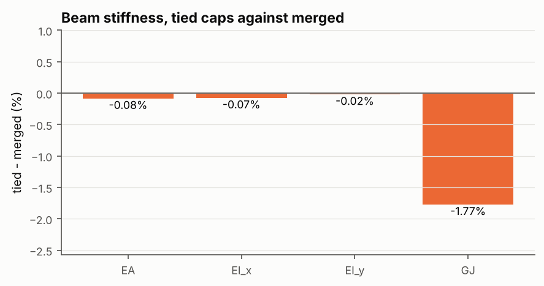

# 27 · Spar caps merged into the skin, or tied to it

A spar cap is laid on the inside of the skin, so the cap and the skin have separate
mid-surfaces. `BladeBuilder.from_geometry` can model this in two ways:

- **`caps="merged"`** (the default) stacks the cap and the skin into one laminate
  along the cap, with the shell on the stack's mid-surface. The skin's reference
  surface steps in by half the cap thickness at each cap edge.
- **`caps="tied"`** keeps the skin on its own mid-surface, unbroken under the cap. The
  cap is a shell of its own on its mid-surface, half the skin thickness plus half the
  cap thickness further in. Every cap node is tied to the skin node facing it by a
  rigid offset link (an RBE2). This is how blade-structure's section shell solver
  models caps (`cap_tie_mode="skin_offset"`).

This example meshes a 5 m NACA 0024 segment (2D-F layout: 3 mm glass skin, 8 mm
carbon caps, two webs) both ways. It compares the beam stiffness, and how a
flapwise moment and a torque split their membrane load between the tied cap and
the skin beneath it.





## Use

```python
blade = BladeBuilder.from_geometry(geo, n_span=20, caps="tied").build(laminates, FSDTModel())
bcs = blade.tie_caps(BoundaryConditions()).clamp(blade.nodes("root"))
```

`blade.ties` maps each cap node to its skin node. `tie_caps` adds the links to a
`BoundaryConditions`, skipping any cap DOF that is already constrained. Cap
elements are in `caps` and in their cap's sets, and the skin under them is in the
skin's sets. Cap nodes are left out of `root`, `tip` and `section_nodes`, because
they follow the skin through the links. Without the links a cap floats, and the
solver stops on a singular stiffness. Constraints may now chain, so a rib or tip
link on the skin nodes reaches the tied caps through them.

## Results

| | EA (N) | EI_x (N m²) | EI_y (N m²) | GJ (N m²) | shear centre x (mm) |
|---|---|---|---|---|---|
| merged | 8.324e8 | 9.287e6 | 2.232e7 | 2.201e6 | 13.4 |
| tied | 8.317e8 | 9.280e6 | 2.232e7 | 2.162e6 | 11.4 |

**Beam stiffness hardly changes.** EA and EI agree to within 0.1%, and GJ is 1.8%
lower with tied caps. A rigid link moves the cap with the skin exactly as a stacked
laminate does, so the two models differ only in geometry:

- where the reference surface steps at the cap edges;
- the webs, which end on the skin's mid-surface rather than the stack's;
- the cap, which joins a web only through the skin.

**The tied cap takes the load a stacked laminate gives it.** At mid-span the cap
carries 94.5% of the axial load of cap plus skin under a flapwise moment. The A11
split of the two laminates gives 94.3%. Under a torque it carries 82% of the shear
flow, against 84% from the A66 split, dropping to 73% at the cap edges where the
load passes into the skin.

blade-structure's notes on cap ties (BL-003) report that a tied cap takes a median
96% of the shear against 67% from its stacked-wall load model. That gap does not
appear here: the tied shell and the stacked split agree within two points. It
probably comes from that load model, which with its default `G_by_kind` splits by
thickness alone, or from its nodal sampling (its notes say the FE share saturates
near 0.98), rather than from the tie itself.

**So which should you use?** For section stiffness and global response, merged is
enough and simpler. Use tied caps when the cap itself matters: its own element
stresses and failure indices, ply drops laid on the cap alone, the load transfer at
the cap edges, or for consistency with blade-structure's sizing models.
`ThinWalledSection.from_blade_mesh` (anisotropic-section-model) cannot read the links,
so build thin-walled sections with `from_geometry` instead.

Run time is about 4 minutes.
